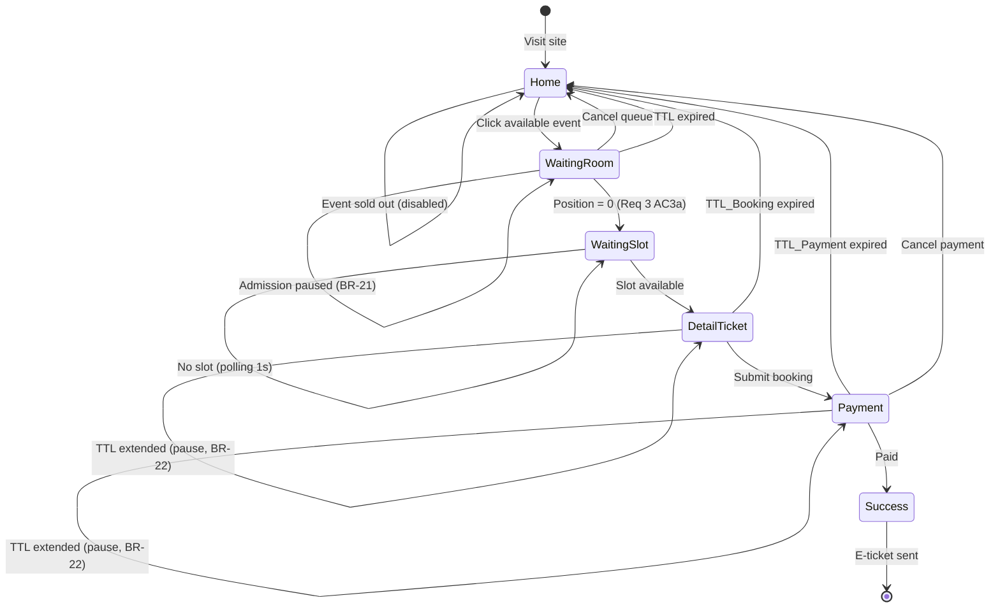
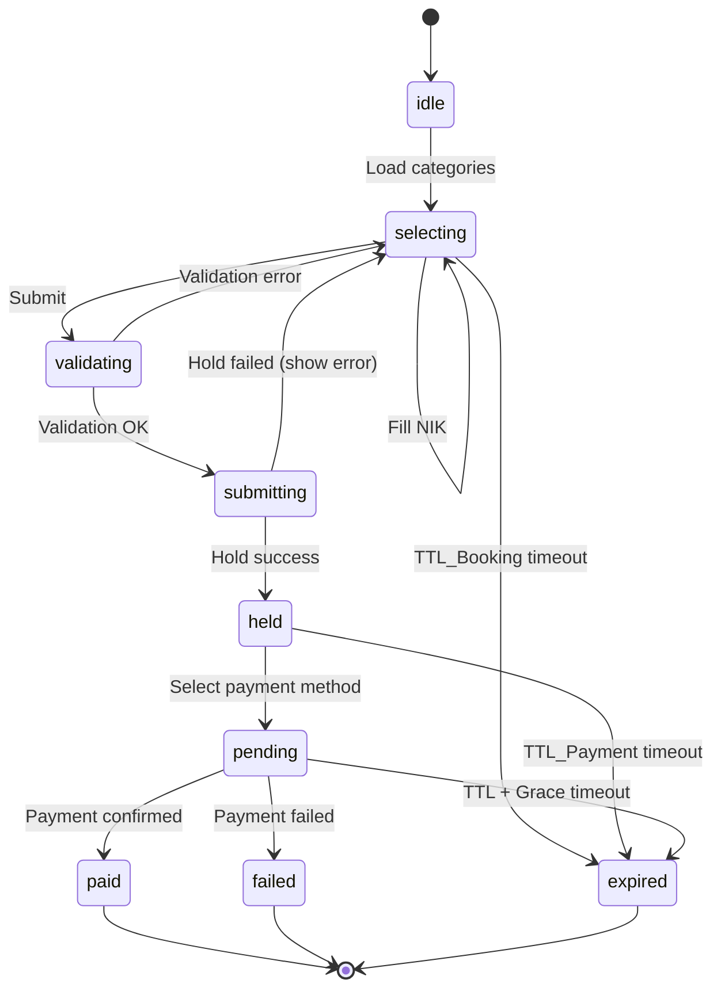
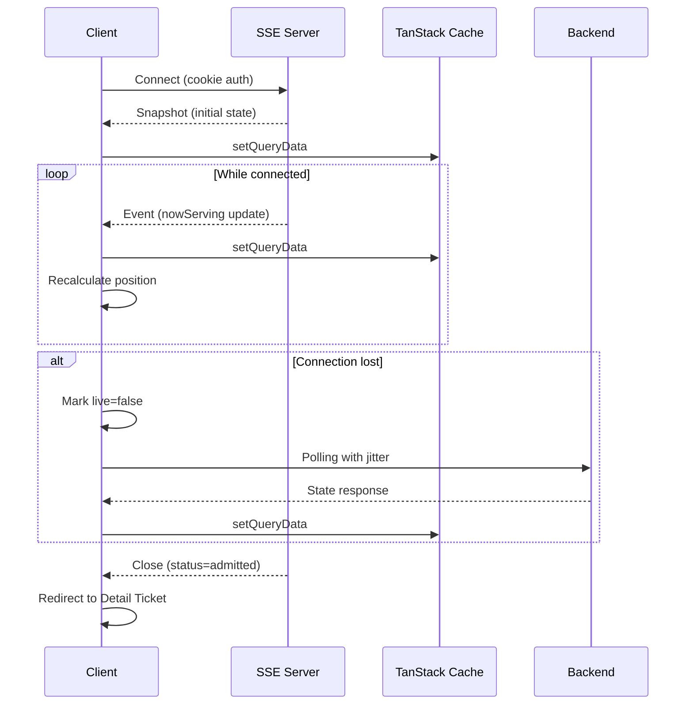

# Design Document: Rusuh Tiket Booking Frontend

## Overview

Dokumen ini menjelaskan desain teknis frontend web **Rusuh Booking Tiket**, sebuah sistem pemesanan tiket konser yang dirancang untuk menangani 200.000–300.000 concurrent users saat flash crowd (lonjakan trafik ekstrem saat penjualan tiket dibuka).

### Tujuan Arsitektur

1. **Murah**: Tidak membangun framework internal. Memakai mekanisme React dan library yang sudah matang. Satu payment page untuk web dan mobile.
2. **Fungsional**: Setiap state alur (expired, stok berubah, pending, sesi diambil alih) dimodelkan eksplisit dan punya layar sendiri.
3. **Andal**: Logika kritis (kuota, timer, transisi state) adalah fungsi murni yang dites tanpa browser. Home statis dari CDN tetap hidup saat flash crowd. Timer server-authoritative.

### Keputusan Arsitektur Kunci

| Keputusan | Referensi | Ringkasan |
|-----------|-----------|-----------|
| Single app dengan feature modules | ADR-0013 | Bukan monorepo; satu aplikasi Next.js dengan folder per fitur |
| Clean Architecture per modul | ADR-0014 | 5 lapisan: domain, application, data, controllers, views |
| Dependency Injection Awilix | ADR-0015 | Composition root, PROXY mode, strict: true |
| SSE untuk real-time updates | ADR-0016 | ~$14/event vs $300 polling; fallback ke polling |
| Server-authoritative time | ADR-0005 | Timer dari `expiresAt` server + offset, bukan countdown lokal |
| Payment via BE (Midtrans Core API) | ADR-0006 | FE tidak pernah memanggil Midtrans langsung |
| TanStack Query untuk server state | ADR-0004 | Cache, retry, polling dengan jitter |

---

## Architecture

### High-Level System Architecture

```
┌─────────────────────────────────────────────────────────────────────────────────────┐
│                                    CLIENT (Browser)                                  │
├─────────────────────────────────────────────────────────────────────────────────────┤
│  ┌───────────────┐  ┌───────────────┐  ┌───────────────┐  ┌───────────────┐        │
│  │   Home Page   │  │ Waiting Room  │  │ Detail Ticket │  │  Payment Page │        │
│  │    (ISR)      │  │    (SSE)      │  │   (Dynamic)   │  │   (Dynamic)   │        │
│  └───────┬───────┘  └───────┬───────┘  └───────┬───────┘  └───────┬───────┘        │
│          │                  │                  │                  │                 │
│          └──────────────────┴──────────────────┴──────────────────┘                 │
│                                      │                                              │
│  ┌───────────────────────────────────┴───────────────────────────────────┐         │
│  │                        TanStack Query Cache                            │         │
│  │                    (Shared cache, SSE writes here)                     │         │
│  └───────────────────────────────────────────────────────────────────────┘         │
│                                      │                                              │
│  ┌───────────────────────────────────┴───────────────────────────────────┐         │
│  │                      Awilix Container (DI)                             │         │
│  │         Use Cases ← Protocols ← Services ← HttpClient/SSE              │         │
│  └───────────────────────────────────────────────────────────────────────┘         │
└─────────────────────────────────────┬───────────────────────────────────────────────┘
                                      │ HTTPS
                                      ▼
┌─────────────────────────────────────────────────────────────────────────────────────┐
│                              EDGE (CDN/Next.js Proxy)                                │
├─────────────────────────────────────────────────────────────────────────────────────┤
│  proxy.ts: JWT verification for /events/*/book and /orders/*/pay                    │
│  Static assets cached at CDN                                                         │
└─────────────────────────────────────┬───────────────────────────────────────────────┘
                                      │
                                      ▼
┌─────────────────────────────────────────────────────────────────────────────────────┐
│                                  BACKEND SERVICES                                    │
├─────────────────────────────────────────────────────────────────────────────────────┤
│  Queue Service ─── Booking Service ─── Payment Service ─── Email Service            │
│       │                   │                   │                                      │
│       └───────────────────┴───────────────────┘                                      │
│                           │                                                          │
│               ┌───────────┴───────────┐                                              │
│               │   Midtrans Gateway    │                                              │
│               └───────────────────────┘                                              │
└─────────────────────────────────────────────────────────────────────────────────────┘
```

### Module Structure

```
src/
├─ app/                     # Next.js App Router (routing, layouts, route handlers)
├─ proxy.ts                 # Edge middleware untuk validasi access token
├─ di/                      # Composition root Awilix
│  ├─ container.ts          # createAppContainer, AppRegistry
│  ├─ core.module.ts        # Registrasi shared dependencies
│  ├─ app-config.reader.ts  # Satu-satunya tempat baca process.env
│  ├─ server-dependencies.ts
│  └─ AppProviders.tsx      # TanStack Query + DI Context Provider
├─ components/ui/           # Design system (Signal DS)
│  ├─ primitives/           # Button, Badge, Card, Alert, Progress, RadioGroup
│  ├─ layout/               # ScreenFrame, CountdownCard, StatusView
│  └─ signal.css            # Token warna Signal
├─ modules/
│  ├─ auth/                 # Autentikasi & registrasi NIK
│  ├─ catalog/              # Daftar event (Home)
│  ├─ queue/                # Waiting Room (SSE)
│  ├─ booking/              # Detail Ticket (pemilihan tiket, NIK)
│  ├─ payment/              # Payment page (VA, GoPay)
│  └─ ticket/               # E-tiket (placeholder)
├─ core/                    # Shared logic, same layer structure
│  ├─ domain/               # AppError, protocols, time utils
│  ├─ application/          # Shared use cases
│  ├─ data/                 # HttpClient, SSE client
│  ├─ controllers/          # Shared hooks (useCountdown, useLiveUpdates)
│  ├─ views/                # ScreenLoading
│  └─ i18n/                 # Pesan ID/EN
├─ mocks/                   # MSW handlers
└─ test/                    # Test support
```

### Dependency Rules (ADR-0014)

```
views → controllers → application (type only) → domain
                                                    ↑
data ─────────────────────────────────────────────┘
```

| Layer | Allowed Imports | Forbidden |
|-------|-----------------|-----------|
| `domain/` | TypeScript murni, `core/domain` | React, Next, zod, awilix, fetch, Date.now() |
| `application/` | `domain`, `core/domain`, `core/application` | Framework, zod, awilix, fetch, Date.now() |
| `data/` | `domain`, `application`, `core/data` | React, Next, awilix, controllers, views |
| `controllers/` | `domain`, `views` (type), `application` (type only) | Import value dari application/data, Date.now() |
| `views/` | `components/ui`, `domain` (type only) | Controller, i18n, hook data |

---

## Components and Interfaces

### Module: auth

**Purpose**: Menangani autentikasi pengguna, registrasi akun, validasi NIK, dan consent management.

#### Domain Layer

```typescript
// auth/domain/user.model.ts
export type User = {
  id: string;
  email: string;
  maskedNik: string; // NIK tersamar "320***********001"
  emailVerified: boolean;
  consentGiven: boolean;
  consentTimestamp: string;
};

export type NikFriend = {
  id: string;
  maskedNik: string;
  addedAt: string;
};

export type NikValidationStatus = 
  | 'VALID' 
  | 'INVALID' 
  | 'PENDING_DUKCAPIL_VALIDATION';
```

```typescript
// auth/domain/auth.protocol.ts
export interface AuthProtocol {
  login(email: string, password: string): Promise<User>;
  register(data: RegisterData): Promise<User>;
  validateNik(nik: string): Promise<NikValidationStatus>;
  getNikFriends(): Promise<NikFriend[]>;
  addNikFriend(nik: string): Promise<NikFriend>;
  removeNikFriend(id: string): Promise<void>;
  requestVerificationLink(email: string): Promise<void>;
}
```

```typescript
// auth/domain/nik-validation.rules.ts
export const NIK_LENGTH = 16;

export function isValidNikFormat(nik: string): boolean {
  return /^\d{16}$/.test(nik);
}

export function maskNik(nik: string): string {
  return nik.slice(0, 3) + '***********' + nik.slice(-3);
}
```

#### Application Layer

```typescript
// auth/application/validate-nik.use-case.ts
export type ValidateNikUseCase = (nik: string) => Promise<NikValidationResult>;

export function createValidateNikUseCase({ authService }: { authService: AuthProtocol }): ValidateNikUseCase {
  return async (nik) => {
    if (!isValidNikFormat(nik)) return { valid: false, reason: 'INVALID_FORMAT' };
    const status = await authService.validateNik(nik);
    return { valid: status === 'VALID', status };
  };
}
```

---

### Module: catalog

**Purpose**: Menampilkan daftar event di Home Page dengan status real-time.

#### Domain Layer

```typescript
// catalog/domain/event.model.ts
export type EventStatus = 'AVAILABLE' | 'SELLING_OUT_FAST' | 'SOLD_OUT';
export type QueueState = 'NOT_OPEN' | 'DIRECT' | 'OPEN' | 'FULL';

export type DisplayBlock = {
  enabled: boolean;
  action: 'queue' | 'book' | 'disabled';
  labelKey: string;
  badgeKey?: string;
};

export type Event = {
  id: string;
  name: string;
  date: string;
  venue: string;
  imageUrl: string;
  status: EventStatus;
  queueState: QueueState;
  display: DisplayBlock;
};
```

```typescript
// catalog/domain/event.constants.ts
// Ref: BR-20 — sold out bersifat sementara, final setelah 930 detik
/** Waktu sebelum sold out menjadi final (15.5 menit = 930 detik) */
export const SOLD_OUT_FINAL_TIMEOUT_SECONDS = 930;

// catalog/domain/sold-out.model.ts
export type SoldOutStatus = 
  | { type: 'temporary'; timeRemainingMs: number } // Masih bisa kembali dari expired booking
  | { type: 'final'; finalAt: string };            // Sudah final setelah 930 detik

export type SoldOutFinalEvent = {
  eventId: string;
  finalAt: string; // ISO timestamp
  reason: 'timeout_930s';
};
```

```typescript
// catalog/domain/event.protocol.ts
export interface EventProtocol {
  getEvents(): Promise<Event[]>;
  getEvent(eventId: string): Promise<Event>;
}
```

#### Controller Layer

```typescript
// catalog/controllers/home.controller.ts
export function useHomeController() {
  const { listEventsUseCase } = useDependencies<CatalogDependencies>();
  
  const eventsQuery = useQuery(eventsQueryOptions(listEventsUseCase));
  
  return {
    events: eventsQuery.data ?? [],
    isLoading: eventsQuery.isLoading,
    error: eventsQuery.error ? toAppError(eventsQuery.error) : null,
  };
}
```

---

### Module: queue

**Purpose**: Waiting Room dengan antrian virtual berbasis SSE.

#### Domain Layer

```typescript
// queue/domain/queue-state.model.ts
// Ref: Req 3 AC3a — status 'waiting_slot' saat posisi 0 tapi belum ada slot
export type QueueState =
  | {
      status: 'waiting';
      eventName: string;
      position: number;
      joinedPosition: number; // Posisi awal untuk progress bar
      etaSeconds: number;
      retryAfterMs: number;
    }
  | {
      status: 'waiting_slot'; // NEW: posisi = 0 tapi belum ada slot (Req 3 AC3a)
      eventName: string;
      pollIntervalMs: 1000; // 1 second polling untuk claim-token
      message: string; // "Giliran Anda sudah tiba — menunggu kasir tersedia"
    }
  | { 
      status: 'admitted'; 
      eventName: string; 
      accessToken: string; 
      expiresAt: string;
    }
  | {
      status: 'paused'; // NEW: sistem dalam pause admission (BR-21)
      eventName: string;
      position: number;
      pausedAt: string;
      reason: 'circuit_breaker_open';
    };
```

```typescript
// queue/domain/queue.protocol.ts
export interface QueueProtocol {
  getQueueState(eventId: string): Promise<QueueState>;
  joinQueue(eventId: string, captchaToken: string): Promise<QueueState>; // captchaToken required (Req 3.22)
  claimToken(eventId: string): Promise<QueueState>;
  cancelQueue(eventId: string): Promise<void>;
}

// queue/domain/queue-updates.protocol.ts
export interface QueueUpdatesProtocol {
  subscribe(
    eventId: string,
    observer: Observer<{ nowServing: number }>
  ): Unsubscribe;
}
```

```typescript
// queue/domain/queue-progress.rules.ts
export const ETA_BUFFER_MULTIPLIER = 1.2; // +20% buffer (BR-11)

export function calculatePosition(
  queueNumber: number, 
  nowServing: number
): number {
  return Math.max(0, queueNumber - nowServing);
}

export function calculateEta(
  position: number,
  avgProcessingRatePerMinute: number
): number {
  const baseEta = (position / avgProcessingRatePerMinute) * 60;
  return Math.ceil(baseEta * ETA_BUFFER_MULTIPLIER);
}
```

#### Application Layer

```typescript
// queue/application/watch-queue-state.use-case.ts
export type WatchQueueStateUseCase = (eventId: string, observer: Observer<QueueState>) => Unsubscribe;

export function createWatchQueueStateUseCase({
  queueUpdatesService,
}: {
  queueService: QueueProtocol;
  queueUpdatesService: QueueUpdatesProtocol;
}): WatchQueueStateUseCase {
  return (eventId, observer) =>
    queueUpdatesService.subscribe(eventId, (update) => {
      // Recalculate position based on nowServing
      observer.next(/* recalculated state */);
    });
}
```

```typescript
// queue/application/join-queue-with-captcha.use-case.ts
// Ref: Req 3.22, Req 12.4 — CAPTCHA tak terlihat saat join antrian
export type JoinQueueWithCaptchaUseCase = (eventId: string) => Promise<QueueState>;

export function createJoinQueueWithCaptchaUseCase({
  queueService,
  captchaService,
}: {
  queueService: QueueProtocol;
  captchaService: CaptchaProtocol;
}): JoinQueueWithCaptchaUseCase {
  return async (eventId) => {
    // Get or refresh CAPTCHA token
    const captchaToken = await captchaService.prefetchToken();
    // Join queue with CAPTCHA token
    return queueService.joinQueue(eventId, captchaToken);
  };
}
```

```typescript
// queue/application/claim-slot.use-case.ts
// Ref: Req 3 AC3a — polling 1 detik saat posisi 0 menunggu slot
export type ClaimSlotUseCase = (eventId: string) => Promise<QueueState>;

export function createClaimSlotUseCase({ queueService }: { queueService: QueueProtocol }): ClaimSlotUseCase {
  return async (eventId) => {
    const state = await queueService.claimToken(eventId);

    // If still waiting for slot, return waiting_slot state
    if (state.status === 'waiting_slot') {
      return {
        status: 'waiting_slot',
        eventName: state.eventName,
        pollIntervalMs: 1000, // 1 second polling per AC3a
        message: 'Giliran Anda sudah tiba — menunggu kasir tersedia. Anda akan diarahkan otomatis segera.',
      };
    }

    return state;
  };
}
```

---

### Module: booking

**Purpose**: Pemilihan tiket, validasi NIK per attendee, dan identitas pemesan.

#### Domain Layer

```typescript
// booking/domain/booking-session.model.ts
export type TicketCategory = {
  id: string;
  name: string;
  priceIdr: number;
  stock: number; // 0 = habis
};

export type BookingQuota = { 
  max: number; 
  used: number; 
  remaining: number;
};

export type BookingSession = {
  eventName: string;
  expiresAt: string; // Server timestamp (ADR-0005)
  serverNow: string;
  maskedNik: string;
  quota: BookingQuota;
  categories: TicketCategory[];
};
```

```typescript
// booking/domain/attendee.model.ts
export type AttendeeInfo = {
  ticketIndex: number;
  categoryId: string;
  nik: string;
  nikSource: 'manual' | 'self' | 'friend';
  nikValidationStatus: 'pending' | 'valid' | 'invalid' | 'duplicate';
};

export type BookingFormState = {
  attendees: AttendeeInfo[];
  buyerEmail: string;
  emailValid: boolean;
};
```

```typescript
// booking/domain/booking.constants.ts
/** BR-01: maksimal tiket per transaksi */
export const MAX_TICKETS_PER_TRANSACTION = 3;

/** BR-03: TTL_Booking dalam detik */
export const TTL_BOOKING_SECONDS = 300; // 5 menit

/** Interval refresh stok (ADR-0004) */
export const STOCK_REFRESH_INTERVAL_MS = 15_000;

/** BR-22: Tambahan waktu TTL saat sistem pause */
export const PAUSE_TTL_GRACE_SECONDS = 60;
```

```typescript
// booking/domain/can-add-ticket.rules.ts
import { MAX_TICKETS_PER_TRANSACTION } from './booking.constants';

export function canAddTicket(
  currentCount: number,
  stock: number
): boolean {
  return currentCount < MAX_TICKETS_PER_TRANSACTION && stock > 0;
}

export function validateTicketSelection(
  selection: Map<string, number>,
  categories: TicketCategory[]
): ValidationResult {
  const totalTickets = Array.from(selection.values())
    .reduce((sum, qty) => sum + qty, 0);
    
  if (totalTickets > MAX_TICKETS_PER_TRANSACTION) {
    return { valid: false, error: 'EXCEEDS_MAX_TICKETS' };
  }
  
  for (const [categoryId, qty] of selection) {
    const category = categories.find(c => c.id === categoryId);
    if (!category || category.stock < qty) {
      return { valid: false, error: 'INSUFFICIENT_STOCK', categoryId };
    }
  }
  
  return { valid: true };
}
```

```typescript
// booking/domain/nik-dedup.rules.ts
export function findDuplicateNiks(niks: string[]): string[] {
  const seen = new Set<string>();
  const duplicates: string[] = [];
  
  for (const nik of niks) {
    if (seen.has(nik)) {
      duplicates.push(nik);
    }
    seen.add(nik);
  }
  
  return duplicates;
}

export function validateNikUniqueness(
  niks: string[]
): { valid: boolean; duplicates: string[] } {
  const duplicates = findDuplicateNiks(niks);
  return {
    valid: duplicates.length === 0,
    duplicates
  };
}
```

```typescript
// booking/domain/selection.reducer.ts
export type SelectionState = {
  quantities: Map<string, number>;
  totalTickets: number;
};

export type SelectionAction =
  | { type: 'INCREMENT'; categoryId: string }
  | { type: 'DECREMENT'; categoryId: string }
  | { type: 'SET'; categoryId: string; quantity: number }
  | { type: 'RESET' };

export function selectionReducer(
  state: SelectionState,
  action: SelectionAction
): SelectionState {
  // Pure reducer logic
}
```

#### Application Layer

```typescript
// booking/application/submit-booking.use-case.ts
export type SubmitBookingUseCase = (data: BookingSubmitData) => Promise<BookingResult>;

export function createSubmitBookingUseCase({ bookingService }: { bookingService: BookingProtocol }): SubmitBookingUseCase {
  return async (data) => {
    // Validasi NIK uniqueness (frontend validation)
    const nikValidation = validateNikUniqueness(data.attendees.map((a) => a.nik));

    if (!nikValidation.valid) {
      return {
        success: false,
        error: 'DUPLICATE_NIK_IN_REQUEST',
        duplicates: nikValidation.duplicates,
      };
    }

    // Submit to backend (atomic hold)
    return bookingService.submitBooking(data);
  };
}
```

---

### Module: payment

**Purpose**: Proses pembayaran dengan VA dan GoPay via Midtrans Core API.

#### Domain Layer

```typescript
// payment/domain/order.model.ts
export type PaymentMethod = 'virtual_account' | 'e_wallet';

export type PaymentInstruction =
  | { type: 'virtual_account'; bank: string; number: string; expiry: string }
  | { type: 'qr'; payload: string }
  | { type: 'deeplink'; url: string };

export type OrderStatus = 
  | 'awaiting_method' 
  | 'pending' 
  | 'paid' 
  | 'failed' 
  | 'expired';

export type OrderItem = {
  categoryName: string;
  quantity: number;
  priceIdr: number;
  attendeeNik: string;
};

export type Order = {
  orderId: string;
  eventName: string;
  items: OrderItem[];
  totalIdr: number;
  expiresAt: string; // Server timestamp
  serverNow: string;
  status: OrderStatus;
  method?: PaymentMethod;
  instruction?: PaymentInstruction;
};
```

```typescript
// payment/domain/payment.constants.ts
/** BR-05: TTL_Pembayaran dalam detik */
export const TTL_PAYMENT_SECONDS = 600; // 10 menit

/** BR-10: Grace period dalam detik */
export const GRACE_PERIOD_SECONDS = 30;

/** Polling interval saat SSE tidak tersambung (ADR-0016) */
export const PAYMENT_STATUS_POLL_INTERVAL_MS = 3_000;
```

```typescript
// payment/domain/order.rules.ts
export function isFinalOrderStatus(status: OrderStatus): boolean {
  return status === 'paid' || status === 'failed' || status === 'expired';
}

// Ref: Req 6 AC19 — bisa ganti metode selama status AWAITING_PAYMENT atau PENDING
export function canChangePaymentMethod(status: OrderStatus): boolean {
  return status === 'awaiting_method' || status === 'pending';
}
```

```typescript
// payment/domain/order.protocol.ts
export interface OrderProtocol {
  getOrder(orderId: string): Promise<Order>;
  selectPaymentMethod(orderId: string, method: PaymentMethod): Promise<Order>;
  /** Ref: Req 6 AC19 — ganti metode pembayaran yang sudah dipilih */
  changePaymentMethod(orderId: string, newMethod: PaymentMethod): Promise<Order>;
  cancelPayment(orderId: string): Promise<void>;
}

// payment/domain/order-updates.protocol.ts
export interface OrderUpdatesProtocol {
  subscribe(orderId: string, observer: Observer<Order>): Unsubscribe;
}
```

```typescript
// payment/application/change-payment-method.use-case.ts
// Ref: Req 6 AC19 — use case untuk ganti metode pembayaran
export type ChangePaymentMethodUseCase = (orderId: string, newMethod: PaymentMethod) => Promise<Order>;

export function createChangePaymentMethodUseCase({ orderService }: { orderService: OrderProtocol }): ChangePaymentMethodUseCase {
  return async (orderId, newMethod) => {
    const order = await orderService.get(orderId);

    if (!canChangePaymentMethod(order.status)) {
      throw new AppFailure({
        kind: 'api',
        code: 'PAYMENT_METHOD_CHANGE_NOT_ALLOWED',
        status: 400,
      });
    }

    return orderService.changePaymentMethod(orderId, newMethod);
  };
}
```

---

### Core Module

**Purpose**: Shared logic yang dipakai lintas modul.

#### Domain Layer

```typescript
// core/domain/app-error.ts
export type ApiErrorCode =
  | 'NIK_INVALID'
  | 'QUOTA_EXCEEDED'
  | 'STOCK_INSUFFICIENT'
  | 'ACCESS_EXPIRED'
  | 'QUEUE_TOKEN_INVALID'
  | 'QUEUE_FULL'
  | 'SLOT_TAKEN_OVER'
  | 'PAYMENT_EXPIRED'
  | 'NIK_ALREADY_USED'
  | 'DUPLICATE_NIK_IN_REQUEST'
  | 'HOLD_EXPIRED'
  | 'INVALID_NIK_FORMAT'
  | 'DUKCAPIL_UNAVAILABLE'
  | 'CAPTCHA_INVALID'           // Req 3.22
  | 'ADMISSION_PAUSED'          // BR-21
  | 'PAYMENT_METHOD_CHANGE_NOT_ALLOWED'; // Req 6 AC19

export type AppError =
  | { kind: 'api'; code: ApiErrorCode; status: number }
  | { kind: 'network' }
  | { kind: 'invalid_response' }
  | { kind: 'unknown'; status?: number };

export class AppFailure extends Error {
  constructor(readonly error: AppError) {
    super(`AppFailure:${error.kind}`);
    this.name = 'AppFailure';
  }
}
```

```typescript
// core/domain/time/remaining-ms.utils.ts
export function remainingMs(
  expiresAt: string,
  clientNow: number,
  serverOffsetMs: number
): number {
  const expiresAtMs = new Date(expiresAt).getTime();
  const adjustedNow = clientNow + serverOffsetMs;
  return Math.max(0, expiresAtMs - adjustedNow);
}

export function computeServerOffset(
  serverNow: string,
  clientNow: number
): number {
  return new Date(serverNow).getTime() - clientNow;
}
```

```typescript
// core/domain/clock.protocol.ts
export interface ClockProtocol {
  now(): number;
}

// core/domain/random.protocol.ts
export interface RandomProtocol {
  random(): number;
}

// core/domain/captcha.protocol.ts
// Ref: Requirements 3.22, 12.4 — CAPTCHA tak terlihat dengan fail-open behavior
export interface CaptchaProtocol {
  prefetchToken(): Promise<string>;
  refreshToken(): Promise<string>;
  validateToken(token: string): Promise<CaptchaValidationResult>;
}

export type CaptchaValidationResult = {
  valid: boolean;
  score?: number;
  failedOpen?: boolean; // true if provider unavailable (fail-open behavior)
};

// core/domain/captcha.constants.ts
/** Prefetch CAPTCHA token 5 menit sebelum sale dibuka (Req 3.22) */
export const CAPTCHA_PREFETCH_BEFORE_SALE_MS = 300_000;

/** Interval refresh token CAPTCHA */
export const CAPTCHA_REFRESH_INTERVAL_MS = 60_000;

// core/domain/system-state.model.ts
// Ref: BR-21 (pause admission saat circuit breaker), BR-22 (TTL +60s saat pause)
export type CircuitBreakerState = 'CLOSED' | 'OPEN' | 'HALF_OPEN';

export type SystemHealthState = {
  dukcapilAvailable: boolean;
  paymentGatewayAvailable: boolean;
  admissionPaused: boolean;
  pausedAt?: string; // ISO timestamp when pause started
  dukcapilCircuitBreaker: CircuitBreakerState;
  paymentCircuitBreaker: CircuitBreakerState;
};

// core/domain/system-health.protocol.ts
export interface SystemHealthProtocol {
  getHealthState(): Promise<SystemHealthState>;
}

// core/domain/system-health-updates.protocol.ts
export interface SystemHealthUpdatesProtocol {
  subscribe(observer: Observer<SystemHealthState>): Unsubscribe;
}
```

#### Data Layer

```typescript
// core/data/http/http-client.ts
export interface HttpClient {
  get<T>(path: string, schema: z.ZodType<T>): Promise<T>;
  post<T>(path: string, body: unknown, schema: z.ZodType<T>): Promise<T>;
  delete(path: string): Promise<void>;
}

// core/data/sse/event-stream-client.ts
export interface EventStreamClient {
  connect<T>(
    url: string,
    eventName: string,
    schema: z.ZodType<T>,
    observer: Observer<T>
  ): Unsubscribe;
}
```

#### Controllers Layer

```typescript
// core/controllers/countdown.hook.ts
export function useCountdown(expiresAt: string | null, serverNow: string | null) {
  const { clock } = useDependencies<CoreDependencies>();
  const [remaining, setRemaining] = useState<number | null>(null);
  
  useEffect(() => {
    if (!expiresAt || !serverNow) return;
    
    const offset = computeServerOffset(serverNow, clock.now());
    
    const tick = () => {
      setRemaining(remainingMs(expiresAt, clock.now(), offset));
    };
    
    tick();
    const intervalId = setInterval(tick, 1000);
    
    return () => clearInterval(intervalId);
  }, [expiresAt, serverNow, clock]);
  
  return remaining;
}
```

```typescript
// core/controllers/live-updates.hook.ts
export function useLiveUpdates<T>(
  key: QueryKey,
  subscribe: (observer: Observer<T>) => Unsubscribe,
  enabled: boolean
) {
  const queryClient = useQueryClient();
  const [live, setLive] = useState(false);
  
  useEffect(() => {
    if (!enabled) return;
    
    const unsubscribe = subscribe({
      next: (data) => {
        queryClient.setQueryData(key, data);
      },
      connected: () => setLive(true),
      disconnected: () => setLive(false),
    });
    
    return unsubscribe;
  }, [key, subscribe, enabled, queryClient]);
  
  return { live };
}
```

---

## Data Models

### API Request/Response DTOs

```typescript
// Event List Response
interface EventListResponse {
  events: Array<{
    id: string;
    name: string;
    date: string;
    venue: string;
    imageUrl: string;
    status: 'AVAILABLE' | 'SELLING_OUT_FAST' | 'SOLD_OUT';
    queueState: 'NOT_OPEN' | 'DIRECT' | 'OPEN' | 'FULL';
    display: {
      enabled: boolean;
      action: 'queue' | 'book' | 'disabled';
      labelKey: string;
      badgeKey?: string;
    };
  }>;
}

// Queue State Response
interface QueueStateResponse {
  status: 'waiting' | 'admitted';
  eventName: string;
  position?: number;
  joinedPosition?: number;
  etaSeconds?: number;
  retryAfterSeconds?: number;
  accessToken?: string;
  expiresAt?: string;
}

// Booking Session Response
interface BookingSessionResponse {
  eventName: string;
  expiresAt: string;
  serverNow: string;
  maskedNik: string;
  quota: {
    max: number;
    used: number;
    remaining: number;
  };
  categories: Array<{
    id: string;
    name: string;
    priceIdr: number;
    stock: number;
  }>;
}

// Submit Booking Request
interface SubmitBookingRequest {
  eventId: string;
  tickets: Array<{
    categoryId: string;
    nikAttendee: string;
  }>;
  buyerEmail: string;
}

// Order Response
interface OrderResponse {
  orderId: string;
  eventName: string;
  items: Array<{
    categoryName: string;
    quantity: number;
    priceIdr: number;
    attendeeNik: string;
  }>;
  totalIdr: number;
  expiresAt: string;
  serverNow: string;
  status: 'awaiting_method' | 'pending' | 'paid' | 'failed' | 'expired';
  method?: 'virtual_account' | 'e_wallet';
  instruction?: PaymentInstruction;
}

// NIK Validation Request
interface NikValidationRequest {
  nik: string;
  eventId: string;
}

// NIK Validation Response
interface NikValidationResponse {
  valid: boolean;
  dukcapilStatus: 'VALID' | 'INVALID' | 'PENDING_DUKCAPIL_VALIDATION';
  availabilityStatus: 'AVAILABLE' | 'ALREADY_USED';
  errorCode?: 'NIK_INVALID' | 'NIK_ALREADY_USED';
}

// API Error Response
interface ApiErrorResponse {
  errorCode: ApiErrorCode;
  message: string;
  details?: Record<string, unknown>;
}
```

### SSE Event Payloads

```typescript
// Queue SSE: /events/{eventId}/queue/stream
// Event name: 'queue'
interface QueueSseEvent {
  nowServing: number;
  timestamp: string;
  // NEW: sistem pause state (BR-21)
  admissionPaused?: boolean;
  pausedAt?: string;
}

// Order SSE: /orders/{orderId}/stream
// Event name: 'order'
interface OrderSseEvent {
  orderId: string;
  status: OrderStatus;
  expiresAt: string;
  serverNow: string;
  method?: PaymentMethod;
  instruction?: PaymentInstruction;
  // NEW: TTL extension saat pause (BR-22)
  pauseExtendedAt?: string; // Timestamp when TTL was extended due to pause
}

// NEW: System SSE: /system/health/stream
// Event name: 'health'
// Ref: BR-21 (pause admission), BR-22 (TTL extension)
interface SystemHealthSseEvent {
  admissionPaused: boolean;
  pausedAt?: string; // ISO timestamp when pause started
  dukcapilCircuitBreaker: 'CLOSED' | 'OPEN' | 'HALF_OPEN';
  paymentCircuitBreaker: 'CLOSED' | 'OPEN' | 'HALF_OPEN';
  timestamp: string;
}

// NEW: Sold Out Final SSE Event (catalog)
// Ref: BR-20 — sold out menjadi final setelah 930 detik
interface SoldOutFinalSseEvent {
  eventId: string;
  finalAt: string;
  reason: 'timeout_930s';
}
```

---

## API Contracts

### REST Endpoints

| Method | Path | Purpose | Auth | Module |
|--------|------|---------|------|--------|
| GET | `/events` | List semua event | - | catalog |
| GET | `/events/{eventId}` | Detail event | - | catalog |
| GET | `/events/{eventId}/queue` | Status antrian | Cookie | queue |
| POST | `/events/{eventId}/queue/join` | Join antrian | Cookie | queue |
| POST | `/events/{eventId}/queue/claim` | Claim token saat posisi 0 | Cookie | queue |
| DELETE | `/events/{eventId}/queue` | Batal antrian | Cookie | queue |
| GET | `/events/{eventId}/booking/session` | Session booking + kategori | Access Token | booking |
| GET | `/events/{eventId}/booking/stock` | Refresh stok saja | Access Token | booking |
| POST | `/events/{eventId}/booking/validate-nik` | Validasi NIK (on-blur) | Access Token | booking |
| POST | `/events/{eventId}/booking/submit` | Submit booking → create order | Access Token | booking |
| GET | `/orders/{orderId}` | Status order | Cookie | payment |
| POST | `/orders/{orderId}/payment` | Pilih metode pembayaran | Cookie | payment |
| PUT | `/orders/{orderId}/payment/method` | Ganti metode pembayaran (Req 6 AC19) | Cookie | payment |
| DELETE | `/orders/{orderId}/payment` | Batalkan pembayaran | Cookie | payment |
| GET | `/api/quota/{nik}/{eventId}` | Cek sisa kuota NIK | Cookie | booking |
| GET | `/me` | Profile user (masked NIK) | Cookie | auth |
| GET | `/me/nik-friends` | Daftar NIK teman | Cookie | auth |
| POST | `/me/nik-friends` | Tambah NIK teman | Cookie | auth |
| DELETE | `/me/nik-friends/{id}` | Hapus NIK teman | Cookie | auth |
| GET | `/time` | Server time untuk offset | - | core |

### SSE Endpoints

| Path | Event Name | Purpose | Auth |
|------|------------|---------|------|
| `/events/{eventId}/queue/stream` | `queue` | Update nowServing real-time | Cookie |
| `/orders/{orderId}/stream` | `order` | Update status pembayaran | Cookie |
| `/system/health/stream` | `health` | System health & pause state (BR-21) | Cookie |

### Error Codes

| Code | HTTP Status | Description |
|------|-------------|-------------|
| `INSUFFICIENT_STOCK` | 409 | Stok tidak mencukupi |
| `QUOTA_EXCEEDED` | 409 | Kuota per NIK sudah terpenuhi (3 tiket) |
| `HOLD_EXPIRED` | 410 | Hold sudah expired |
| `INVALID_NIK_FORMAT` | 400 | NIK bukan 16 digit angka |
| `DUPLICATE_NIK_IN_REQUEST` | 400 | NIK sama dalam satu request |
| `NIK_ALREADY_USED` | 409 | NIK sudah dipakai di event yang sama |
| `ACCESS_EXPIRED` | 401 | Access token expired |
| `QUEUE_TOKEN_INVALID` | 401 | Token antrian invalid |
| `QUEUE_FULL` | 503 | Antrian penuh (300.000) |
| `SLOT_TAKEN_OVER` | 409 | Slot diambil sesi lain |
| `PAYMENT_EXPIRED` | 410 | TTL pembayaran habis |
| `DUKCAPIL_UNAVAILABLE` | 503 | Layanan Dukcapil tidak tersedia |
| `CAPTCHA_INVALID` | 400 | CAPTCHA token invalid (Req 3.22) |
| `ADMISSION_PAUSED` | 503 | Sistem sedang pause admission (BR-21) |
| `PAYMENT_METHOD_CHANGE_NOT_ALLOWED` | 400 | Tidak bisa ganti metode di status ini (Req 6 AC19) |

---

## State Management

### TanStack Query Configuration

```typescript
// Query client configuration
const queryClient = new QueryClient({
  defaultOptions: {
    queries: {
      staleTime: 0,
      gcTime: 5 * 60 * 1000, // 5 minutes
      retry: 3,
      retryDelay: (attemptIndex) => Math.min(1000 * 2 ** attemptIndex, 30000),
    },
    mutations: {
      retry: 0,
    },
  },
});
```

### Query Keys

```typescript
// catalog/controllers/catalog.queries.ts
export const catalogKeys = {
  all: ['catalog'] as const,
  events: () => [...catalogKeys.all, 'events'] as const,
  event: (eventId: string) => [...catalogKeys.all, 'event', eventId] as const,
};

// queue/controllers/queue.queries.ts
export const queueKeys = {
  all: ['queue'] as const,
  state: (eventId: string) => [...queueKeys.all, 'state', eventId] as const,
};

// booking/controllers/booking.queries.ts
export const bookingKeys = {
  all: ['booking'] as const,
  session: (eventId: string) => [...bookingKeys.all, 'session', eventId] as const,
  stock: (eventId: string) => [...bookingKeys.all, 'stock', eventId] as const,
  quota: (nik: string, eventId: string) => [...bookingKeys.all, 'quota', nik, eventId] as const,
};

// payment/controllers/payment.queries.ts
export const paymentKeys = {
  all: ['payment'] as const,
  order: (orderId: string) => [...paymentKeys.all, 'order', orderId] as const,
};

// core/controllers/system.queries.ts
// Ref: BR-21, BR-22 — system health state untuk pause admission
export const systemKeys = {
  all: ['system'] as const,
  health: () => [...systemKeys.all, 'health'] as const,
};
```

### Polling Configuration

| Query | Interval | Jitter | Condition |
|-------|----------|--------|-----------|
| Queue state | From server `retryAfterMs` | ±20% | SSE not connected |
| Claim slot (waiting_slot) | 1s | None | Position = 0, no slot available (Req 3 AC3a) |
| Stock refresh | 15s | ±20% | Always |
| Order status | 3s | ±20% | SSE not connected |
| System health | 10s | ±20% | SSE not connected (BR-21) |

### Local State (useReducer)

```typescript
// Ticket selection state
type SelectionState = {
  quantities: Map<string, number>;
  totalTickets: number;
};

// Booking form state
type BookingFormState = {
  attendees: AttendeeInfo[];
  buyerEmail: string;
  validation: ValidationState;
};

// UI state (modals, dialogs)
type UIState = {
  showCancelDialog: boolean;
  showExitDialog: boolean;
};
```

---

## Correctness Properties

*A property is a characteristic or behavior that should hold true across all valid executions of a system—essentially, a formal statement about what the system should do. Properties serve as the bridge between human-readable specifications and machine-verifiable correctness guarantees.*

### Property 1: NIK Format Validation

*For any* input string, the system SHALL accept it as a valid NIK if and only if it consists of exactly 16 numeric digits.

**Validates: Requirements 0.2, 10.6, 10.7**

### Property 2: NIK Uniqueness Within Transaction

*For any* array of NIK entries in a booking form, if there exist two entries with the same NIK value, the form validation SHALL fail and identify all duplicate NIKs.

**Validates: Requirements 0.6, 4.6**

### Property 3: Ticket Count Equals NIK Form Count

*For any* ticket selection where N tickets are selected (1 ≤ N ≤ 3), the booking form SHALL render exactly N NIK input fields, one for each attendee.

**Validates: Requirements 0.5, 4.5**

### Property 4: Event Status to UI State Mapping

*For any* event with display block from server, the UI SHALL render the event as enabled if `display.enabled` is true, and disabled otherwise, without computing status precedence locally.

**Validates: Requirements 1.2, 1.3, 1.7**

### Property 5: Queue Position Display Format

*For any* queue state with position N where N > 0, the UI SHALL display "Anda antrian ke-{N}" exactly as calculated from `queueNumber - nowServing`.

**Validates: Requirements 3.1, 3.18**

### Property 6: Estimated Wait Time Buffer

*For any* average processing rate R and queue position P, the estimated wait time SHALL be at least P/R × 1.2 (20% buffer applied).

**Validates: Requirements 3.8, BR-11**

### Property 7: Category Disabled When Stock Zero

*For any* ticket category with stock equal to 0, the category selection UI SHALL be disabled and unclickable.

**Validates: Requirements 4.3, 4.12**

### Property 8: Total Ticket Limit Enforcement

*For any* ticket selection attempt that would result in more than 3 total tickets, the increment action SHALL be blocked and the submit button SHALL be disabled.

**Validates: Requirements 4.4, BR-01**

### Property 9: Email Format Validation

*For any* input string in the buyer email field, validation SHALL pass if and only if the string contains at least one `@` character followed by a domain with at least one `.` character.

**Validates: Requirements 4.13**

### Property 10: Server-Synced Countdown Calculation

*For any* server timestamp `expiresAt` and computed offset, the countdown displayed SHALL equal `max(0, expiresAt - (clientNow + offset))` in milliseconds, recalculated every tick.

**Validates: Requirements 5.1, 5.2, 5.3, 6.1**

### Property 11: Payment Instruction Type Mapping

*For any* payment instruction from server, the UI SHALL render the appropriate payment UI component based on instruction type: VA number for `virtual_account`, QR code for `qr`, deep link for `deeplink`.

**Validates: Requirements 6.3, 6.11**

### Property 12: Error Code to i18n Mapping

*For any* API error code returned by backend, the controller SHALL map it to a localized message key, and the view SHALL display the translated message in the current language.

**Validates: Requirements 4.16, 13.5**

### Property 13: Language Toggle Consistency

*For any* language selection (ID or EN), all UI text elements on the current page SHALL be rendered in the selected language without mixing.

**Validates: Requirements 13.2, 13.3**

### Property 14: Pause TTL Grace Extension

*For any* booking or payment session with active TTL when system pause begins (circuit breaker OPEN), the TTL expiry SHALL be extended by exactly PAUSE_TTL_GRACE_SECONDS (60 seconds) from pause start time.

**Validates: Requirements BR-21, BR-22**

### Property 15: CAPTCHA Token Prefetch Before Sale

*For any* event with sale start time T, the system SHALL prefetch CAPTCHA token at time T - CAPTCHA_PREFETCH_BEFORE_SALE_MS (5 minutes before), ensuring no interactive puzzle is required when joining queue.

**Validates: Requirements 3.22, 12.4**

### Property 16: Waiting Slot State Polling

*For any* queue state where position equals 0 and no slot is available, the system SHALL transition to 'waiting_slot' status and poll claim-token endpoint at exactly 1 second intervals until slot becomes available.

**Validates: Requirements 3.3a**

### Property 17: Sold Out Finality Timeout

*For any* event with SOLD_OUT status, the status SHALL remain temporary (allowing returns from expired bookings) for SOLD_OUT_FINAL_TIMEOUT_SECONDS (930 seconds), after which it becomes final.

**Validates: Requirements BR-20**

---

## Error Handling

### Error Flow

```
Backend Error → HttpClient → AppFailure → Use Case → Controller → Mapper → View
                   │                         │            │          │
                   └── Parse error code      │            │          │
                                             │            │          │
                                 Rethrow or return error  │          │
                                                          │          │
                                      Map AppError to i18n key       │
                                                                     │
                                                    Display localized message
```

### Error Handling Patterns

```typescript
// Controller error handling
export function useBookingController() {
  const mutation = useMutation({
    mutationFn: (data) => submitBookingUseCase.execute(data),
    onError: (error) => {
      const appError = toAppError(error);
      // Error is available in mutation.error
    },
  });
  
  return {
    error: mutation.error ? toAppError(mutation.error) : null,
    errorMessage: mutation.error 
      ? t(mapErrorToI18nKey(toAppError(mutation.error)))
      : null,
  };
}
```

```typescript
// Error to i18n key mapping
export function mapErrorToI18nKey(error: AppError): string {
  if (error.kind === 'api') {
    return `error.${error.code.toLowerCase()}`;
  }
  if (error.kind === 'network') {
    return 'error.network';
  }
  return 'error.unknown';
}
```

### Retry Strategies

| Error Type | Retry | Strategy |
|------------|-------|----------|
| Network error | Yes | Exponential backoff, max 3 times |
| 5xx errors | Yes | Exponential backoff, max 3 times |
| 4xx errors | No | Display error immediately |
| `DUKCAPIL_UNAVAILABLE` | No | Display error, offer retry button |

---

## Testing Strategy

### Test Pyramid

```
        ┌─────────┐
        │   E2E   │  Playwright - Critical user journeys
        │ (few)   │
        ├─────────┤
        │ Integ.  │  Controller tests with MSW
        │ (some)  │
        ├─────────┤
        │  Unit   │  Domain, rules, mappers, reducers
        │ (many)  │  Pure functions, no mocking
        └─────────┘
```

### Unit Testing (Pure Functions)

```typescript
// Domain rules - pure functions
describe('canAddTicket', () => {
  it('returns true when under limit and stock available', () => {
    expect(canAddTicket(2, 5)).toBe(true);
  });
  
  it('returns false when at limit', () => {
    expect(canAddTicket(3, 5)).toBe(false);
  });
  
  it('returns false when no stock', () => {
    expect(canAddTicket(1, 0)).toBe(false);
  });
});

// NIK validation - property-based
describe('NIK validation', () => {
  it.prop('accepts exactly 16 digits', [fc.string()])((input) => {
    const isValid = isValidNikFormat(input);
    const expected = /^\d{16}$/.test(input);
    expect(isValid).toBe(expected);
  });
});
```

### Integration Testing (Controller + MSW)

```typescript
// Controller tests with MSW handlers
describe('useBookingController', () => {
  it('submits booking and navigates to payment', async () => {
    server.use(
      http.post('/api/events/:eventId/booking/submit', () => {
        return HttpResponse.json({ orderId: 'order-123' });
      })
    );
    
    const { result } = renderHook(() => useBookingController(), {
      wrapper: createTestWrapper(),
    });
    
    await act(() => result.current.submitBooking(validData));
    
    expect(mockRouter.push).toHaveBeenCalledWith('/orders/order-123/pay');
  });
});
```

### E2E Testing (Playwright)

```typescript
// Critical user journey
test('complete booking flow', async ({ page }) => {
  // Start from home
  await page.goto('/');
  await page.click('[data-testid="event-card"]');
  
  // Wait in queue (mock instant admission)
  await expect(page).toHaveURL(/\/events\/.*\/book/);
  
  // Select tickets
  await page.click('[data-testid="category-increment"]');
  await page.fill('[data-testid="nik-input-0"]', '1234567890123456');
  await page.fill('[data-testid="email-input"]', 'test@example.com');
  await page.click('[data-testid="submit-booking"]');
  
  // Payment
  await expect(page).toHaveURL(/\/orders\/.*\/pay/);
  await page.click('[data-testid="method-va"]');
  await expect(page.locator('[data-testid="va-number"]')).toBeVisible();
});
```

### Test Coverage Requirements

| Layer | Target Coverage |
|-------|-----------------|
| `domain/` | 90% |
| `application/` | 85% |
| `data/` | 80% |
| `controllers/` | 80% |
| `src/di/` | 85% |

---

## Security Considerations

### Authentication & Authorization

1. **Cookie-based session**: HttpOnly, Secure, SameSite=Strict
2. **Access token validation at edge (proxy.ts)**: JWT signature verification
3. **Token tidak di URL**: SSE menggunakan cookie, bukan query param

### Input Validation

1. **NIK**: 16 digit numeric, validated client & server
2. **Email**: Format validation client-side, verification server-side
3. **XSS prevention**: React's default escaping, no `dangerouslySetInnerHTML`

### API Security

1. **CORS**: Strict origin validation
2. **Rate limiting**: Handled by backend
3. **CSRF**: Double-submit cookie pattern (if needed)

### Payment Security

1. **FE never calls Midtrans**: All payment via BE (ADR-0006)
2. **No sensitive data in FE**: VA numbers are display-only
3. **Status from server**: Ignore URL params, always query backend

### Data Protection

1. **NIK masking**: Display masked NIK in UI
2. **Minimal data retention**: No sensitive data in localStorage
3. **Consent tracking**: Record consent for NIK friend storage

---

## Performance Optimizations

### Rendering Strategy (ADR-0007)

| Page | Strategy | Reason |
|------|----------|--------|
| Home | Static/ISR (15s) | Survive flash crowd at CDN |
| Waiting Room | Static shell + Client | Shell from CDN, only SSE is dynamic |
| Detail Ticket | Dynamic | Requires access token |
| Payment | Dynamic | Requires valid session |

### Bundle Optimization

1. **Route-based code splitting**: Each page is its own chunk
2. **Tree shaking**: Dead code elimination
3. **No MSW in production**: Conditional import based on env

### Real-time Updates

1. **SSE over polling**: ~21× cheaper ($14 vs $300 per event)
2. **Single cache write**: SSE writes to TanStack Query cache
3. **Heartbeat**: Server sends `:` comment every 10s to keep connection

### Network Optimization

1. **Polling with jitter**: ±20% to avoid thundering herd
2. **Exponential backoff**: On error, prevent hammering server
3. **CDN for static assets**: Images, fonts, CSS

---

## Diagrams

### User Journey Flow



### Booking State Machine (Frontend)



### SSE Connection Flow



---

## References

- [ADR-0013: Single app dengan feature modules](../../../docs/adr/0013-single-app-modular-structure.md)
- [ADR-0014: Clean Architecture per modul](../../../docs/adr/0014-modular-clean-architecture-solid.md)
- [ADR-0015: Dependency Injection Awilix](../../../docs/adr/0015-dependency-injection-awilix.md)
- [ADR-0016: SSE untuk real-time updates](../../../docs/adr/0016-realtime-updates-sse.md)
- [ADR-0005: Server-authoritative time](../../../docs/adr/0005-server-authoritative-time.md)
- [ADR-0006: Payment via Midtrans Core API](../../../docs/adr/0006-payment-midtrans-core-api.md)
- [ADR-0004: TanStack Query](../../../docs/adr/0004-server-state-tanstack-query.md)
- [ADR-0012: Signal DS](../../../docs/adr/0012-signal-ds-tokens-and-primitives.md)
- [Architecture Overview](../../../docs/architecture/overview.md)
