# Design Document: Rusuh Tiket Booking Frontend

## Overview

Dokumen ini menjelaskan desain teknis frontend web **Rusuh Booking Tiket**, sebuah sistem pemesanan tiket konser yang dirancang untuk menangani 200.000–300.000 concurrent users saat flash crowd (lonjakan trafik ekstrem saat penjualan tiket dibuka).

> **Sumber kebenaran API**: [kontrak API v2.1](https://github.com/PTServerJanganTumbang-BookingTicket/documentations/blob/main/api/api-contracts.md) dan [OpenAPI](https://github.com/PTServerJanganTumbang-BookingTicket/documentations/blob/main/api/rusuh-booking-openapi.yaml) di repo `documentations`. Bila dokumen ini berbeda dengan kontrak, kontrak yang berlaku. Contoh tipe dan alur di dokumen ini ditulis sebelum kontrak diselaraskan, dan kode FE masih memakai bentuk lama sampai integrasi selesai. Login bersifat opsional, batas tiket mengikuti BR-01 (3 per transaksi) dan BR-02 (1 NIK per tiket), dan status pembayaran memakai polling.

### Tujuan Arsitektur

1. **Murah**: Tidak membangun framework internal. Memakai mekanisme React dan library yang sudah matang. Satu payment page untuk web dan mobile.
2. **Fungsional**: Setiap state alur (expired, stok berubah, pending, sesi diambil alih) dimodelkan eksplisit dan punya layar sendiri.
3. **Andal**: Logika kritis (kuota, timer, transisi state) adalah fungsi murni yang dites tanpa browser. Home statis dari CDN tetap hidup saat flash crowd. Timer server-authoritative.

### Keputusan Arsitektur Kunci

| Keputusan | Referensi | Ringkasan |
|-----------|-----------|-----------|
| Single app dengan feature modules | ADR-0013 | Bukan monorepo; satu aplikasi Next.js dengan folder per fitur |
| Clean Architecture per modul | ADR-0014 | 5 lapisan: domain, application, data, controllers, views |
| Dependency Injection Awilix | ADR-0015 | Composition root, PROXY mode, strict: true |
| SSE untuk antrian, polling untuk status pembayaran | ADR-0016, kontrak Appendix B | Antrian disiarkan ke banyak klien; status pembayaran milik satu klien |
| Server-authoritative time | ADR-0005 | Timer dari `expiresAt` server + offset, bukan countdown lokal |
| Payment via BE (Midtrans Core API) | ADR-0006 | FE tidak pernah memanggil Midtrans langsung |
| TanStack Query untuk server state | ADR-0004 | Cache, retry, polling dengan jitter |
| Payment instruction renderer | ADR-0022 | Composable renderer registry; `PaymentView` tidak tahu detail tiap metode |
| Mobile WebView payment handoff | ADR-007 | Handoff code + payment session; kredensial tidak di URL; satu halaman web untuk desktop dan mobile |

---

## User Journey Flow (High-Level)

Diagram berikut menggambarkan perjalanan pengguna dari mengakses Home Page hingga mendapatkan E-Ticket:

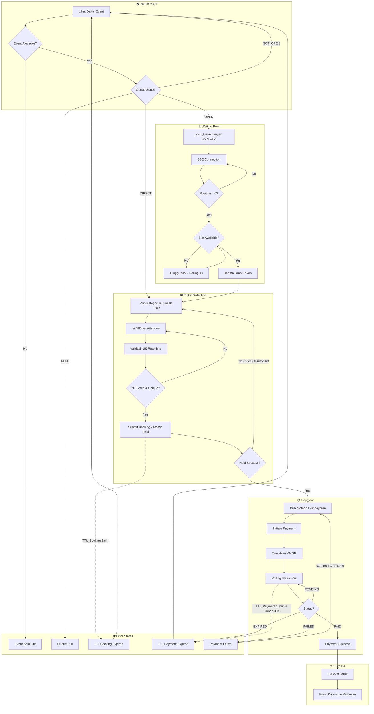

### User Journey State Transitions

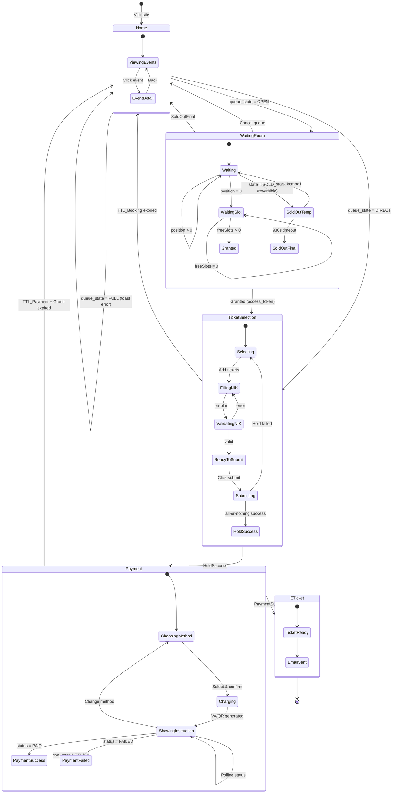

---

## Architecture

### High-Level System Architecture

```
┌─────────────────────────────────────────────────────────────────────────────────────┐
│                                    CLIENT (Browser)                                  │
├─────────────────────────────────────────────────────────────────────────────────────┤
│  ┌───────────────┐  ┌───────────────┐  ┌───────────────┐  ┌───────────────┐        │
│  │   Home Page   │  │ Waiting Room  │  │ Detail Ticket │  │  Payment Page │        │
│  │    (ISR)      │  │    (SSE)      │  │   (Dynamic)   │  │   (Dynamic)   │        │
│  └───────┬───────┘  └───────┬───────┘  └───────┬───────┘  └───────┬───────┘        │
│          │                  │                  │                  │                 │
│          └──────────────────┴──────────────────┴──────────────────┘                 │
│                                      │                                              │
│  ┌───────────────────────────────────┴───────────────────────────────────┐         │
│  │                        TanStack Query Cache                            │         │
│  │                    (Shared cache, SSE writes here)                     │         │
│  └───────────────────────────────────────────────────────────────────────┘         │
│                                      │                                              │
│  ┌───────────────────────────────────┴───────────────────────────────────┐         │
│  │                      Awilix Container (DI)                             │         │
│  │         Use Cases ← Protocols ← Services ← HttpClient/SSE              │         │
│  └───────────────────────────────────────────────────────────────────────┘         │
└─────────────────────────────────────┬───────────────────────────────────────────────┘
                                      │ HTTPS
                                      ▼
┌─────────────────────────────────────────────────────────────────────────────────────┐
│                              EDGE (CDN/Next.js Proxy)                                │
├─────────────────────────────────────────────────────────────────────────────────────┤
│  proxy.ts: JWT verification for /events/*/book and /orders/*/pay                    │
│  Static assets cached at CDN                                                         │
└─────────────────────────────────────┬───────────────────────────────────────────────┘
                                      │
                                      ▼
┌─────────────────────────────────────────────────────────────────────────────────────┐
│                                  BACKEND SERVICES                                    │
├─────────────────────────────────────────────────────────────────────────────────────┤
│  Queue Service ─── Booking Service ─── Payment Service ─── Email Service            │
│       │                   │                   │                                      │
│       └───────────────────┴───────────────────┘                                      │
│                           │                                                          │
│               ┌───────────┴───────────┐                                              │
│               │   Midtrans Gateway    │                                              │
│               └───────────────────────┘                                              │
└─────────────────────────────────────────────────────────────────────────────────────┘
```

### Module Structure

```
src/
├─ app/                     # Next.js App Router (routing, layouts, route handlers)
├─ proxy.ts                 # Edge middleware untuk validasi access token
├─ di/                      # Composition root Awilix
│  ├─ container.ts          # createAppContainer, AppRegistry
│  ├─ core.module.ts        # Registrasi shared dependencies
│  ├─ app-config.reader.ts  # Satu-satunya tempat baca process.env
│  ├─ server-dependencies.ts
│  └─ AppProviders.tsx      # TanStack Query + DI Context Provider
├─ components/ui/           # Design system (Signal DS)
│  ├─ primitives/           # Button, Badge, Card, Alert, Progress, RadioGroup
│  ├─ layout/               # ScreenFrame, CountdownCard, StatusView
│  └─ signal.css            # Token warna Signal
├─ modules/
│  ├─ auth/                 # Autentikasi & registrasi NIK
│  ├─ catalog/              # Daftar event (Home)
│  ├─ queue/                # Waiting Room (SSE)
│  ├─ booking/              # Detail Ticket (pemilihan tiket, NIK)
│  ├─ payment/              # Payment page (VA, GoPay); views/renderers/ via ADR-0022
│  └─ ticket/               # E-tiket (placeholder)
├─ core/                    # Shared logic, same layer structure
│  ├─ domain/               # AppError, protocols, time utils
│  ├─ application/          # Shared use cases
│  ├─ data/                 # HttpClient, SSE client
│  ├─ controllers/          # Shared hooks (useCountdown, useLiveUpdates)
│  ├─ views/                # ScreenLoading
│  └─ i18n/                 # Pesan ID/EN
├─ mocks/                   # MSW handlers
└─ test/                    # Test support
```

### Dependency Rules (ADR-0014)

```
views → controllers → application (type only) → domain
                                                    ↑
data ─────────────────────────────────────────────┘
```

| Layer | Allowed Imports | Forbidden |
|-------|-----------------|-----------|
| `domain/` | TypeScript murni, `core/domain` | React, Next, zod, awilix, fetch, Date.now() |
| `application/` | `domain`, `core/domain`, `core/application` | Framework, zod, awilix, fetch, Date.now() |
| `data/` | `domain`, `application`, `core/data` | React, Next, awilix, controllers, views |
| `controllers/` | `domain`, `views` (type), `application` (type only) | Import value dari application/data, Date.now() |
| `views/` | `components/ui`, `domain` (type only) | Controller, i18n, hook data |

---

## Components and Interfaces

### Module: auth

**Purpose**: Menangani autentikasi pengguna, registrasi akun, validasi NIK, dan consent management.

#### Authentication Flow Diagrams

##### Magic Link Login Flow

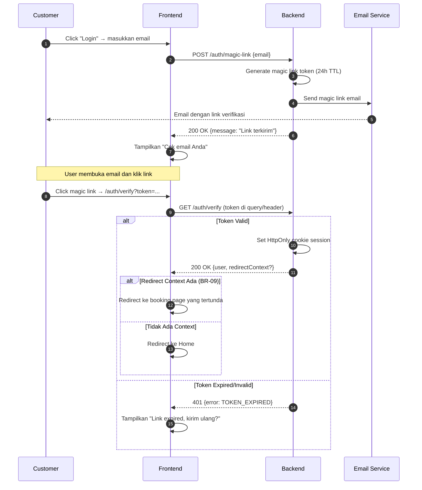

##### Registration Flow dengan NIK Validation & Consent

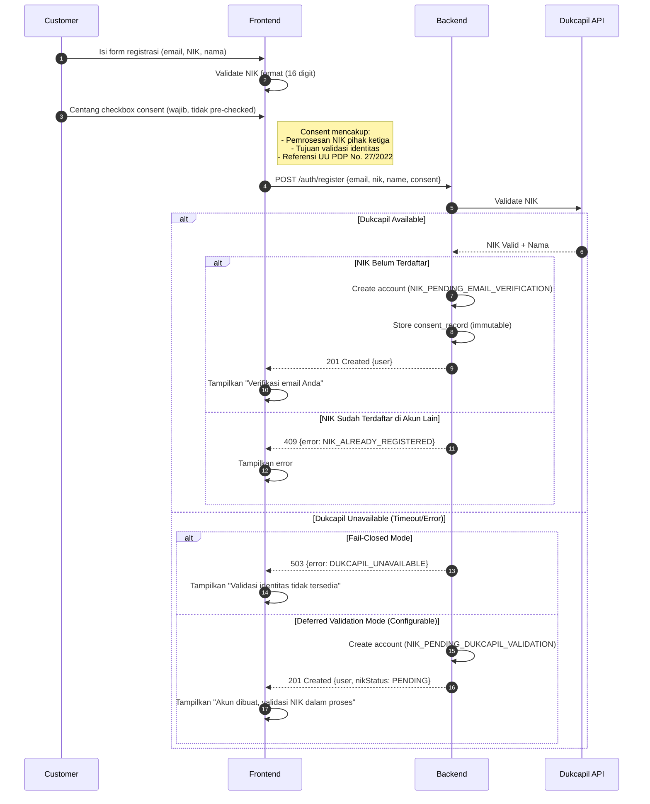

##### Saved NIKs Management Flow

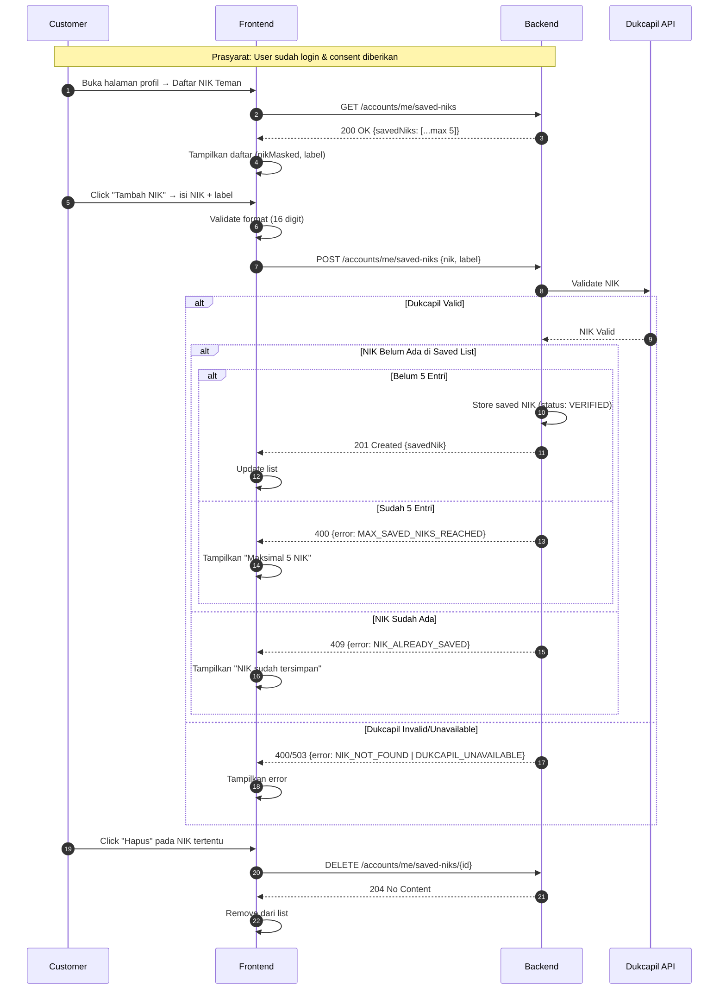

#### Domain Layer

```typescript
// auth/domain/user.model.ts
export type User = {
  id: string;
  email: string;
  maskedNik: string; // NIK tersamar "320***********001"
  emailVerified: boolean;
  consentGiven: boolean;
  consentTimestamp: string;
};

export type SavedNik = {
  id: string;
  nikMasked: string;    // "3171********22"
  label: string;        // Nama alias ("Budi")
  verifiedAt: string;   // ISO timestamp — always set (DB: CHECK verified_at IS NOT NULL)
  status: 'VERIFIED';   // Only verified entries are stored
};

// REMOVE NikFriend type — replaced by SavedNik above

export type NikValidationStatus = 
  | 'VALID' 
  | 'INVALID' 
  | 'PENDING_DUKCAPIL_VALIDATION';

export type MagicLinkContext = {
  type: string; // Contoh: "booking" (BR-09)
  eventId?: string;
  bookingId?: string;
};

export type LoginResult = {
  user: User;
  redirectContext?: MagicLinkContext;
};
```

```typescript
// auth/domain/auth.protocol.ts
// Login magic link sesuai kontrak API §1 (ADR-0023, Proposed). Login bersifat opsional.
export interface AuthProtocol {
  requestMagicLink(email: string): Promise<void>; // POST /auth/magic-link
  resendMagicLink(email: string): Promise<void>; // POST /auth/magic-link/resend
  verifyMagicLink(): Promise<LoginResult>; // GET /auth/verify, cara kirim token masih usulan di ADR-0023
  register(data: RegisterData): Promise<void>; // POST /auth/register
  getSavedNiks(): Promise<SavedNik[]>; // GET /accounts/me/saved-niks
  addSavedNik(nik: string, label: string): Promise<SavedNik>; // POST /accounts/me/saved-niks
  removeSavedNik(id: string): Promise<void>; // DELETE /accounts/me/saved-niks/{id}
}

export type AuthResult = {
  accessToken: string;
  refreshToken: string;
  expiresIn: number;
  user: User;
  redirectContext?: BookingRedirectContext; // BR-09: restore in-progress booking
};

export type BookingRedirectContext = {
  type: 'booking';
  eventId: string;
  bookingId?: string;
  message: string;
};

export type RegisterData = {
  email: string;
  nik: string;
  name: string;
  consent: { accepted: true; policyVersion: string }; // Wajib, checkbox tidak boleh pre-checked
};
```

```typescript
// auth/domain/nik-validation.rules.ts
export const NIK_LENGTH = 16;

export function isValidNikFormat(nik: string): boolean {
  return /^\d{16}$/.test(nik);
}

export function maskNik(nik: string): string {
  return nik.slice(0, 3) + '***********' + nik.slice(-3);
}
```

#### Application Layer

```typescript
// auth/application/validate-nik.use-case.ts
export type ValidateNikUseCase = (nik: string) => Promise<NikValidationResult>;

export function createValidateNikUseCase({ authService }: { authService: AuthProtocol }): ValidateNikUseCase {
  return async (nik) => {
    if (!isValidNikFormat(nik)) return { valid: false, reason: 'INVALID_FORMAT' };
    const status = await authService.validateNik(nik);
    return { valid: status === 'VALID', status };
  };
}
```

---

### Module: catalog

**Purpose**: Menampilkan daftar event di Home Page dengan status real-time.

#### Domain Layer

```typescript
// catalog/domain/event.model.ts
export type EventStatus = 'AVAILABLE' | 'SELLING_OUT_FAST' | 'SOLD_OUT';
export type QueueState = 'NOT_OPEN' | 'DIRECT' | 'OPEN' | 'FULL';

export type DisplayBlock = {
  enabled: boolean;
  action: 'queue' | 'book' | 'disabled';
  labelKey: string;
  badgeKey?: string;
};

export type Event = {
  id: string;
  name: string;
  date: string;
  venue: string;
  imageUrl: string;
  status: EventStatus;
  queueState: QueueState;
  display: DisplayBlock;
};
```

```typescript
// catalog/domain/event.constants.ts
// Ref: BR-20 — sold out bersifat sementara, final setelah 930 detik
/** Waktu sebelum sold out menjadi final (15.5 menit = 930 detik) */
export const SOLD_OUT_FINAL_TIMEOUT_SECONDS = 930;

// catalog/domain/sold-out.model.ts
export type SoldOutStatus = 
  | { type: 'temporary'; timeRemainingMs: number } // Masih bisa kembali dari expired booking
  | { type: 'final'; finalAt: string };            // Sudah final setelah 930 detik

export type SoldOutFinalEvent = {
  eventId: string;
  finalAt: string; // ISO timestamp
  reason: 'timeout_930s';
};
```

```typescript
// catalog/domain/event.protocol.ts
export interface EventProtocol {
  getEvents(): Promise<Event[]>;
  getEvent(eventId: string): Promise<Event>;
}
```

#### Controller Layer

```typescript
// catalog/controllers/home.controller.ts
export function useHomeController() {
  const { listEventsUseCase } = useDependencies<CatalogDependencies>();
  
  const eventsQuery = useQuery(eventsQueryOptions(listEventsUseCase));
  
  return {
    events: eventsQuery.data ?? [],
    isLoading: eventsQuery.isLoading,
    error: eventsQuery.error ? toAppError(eventsQuery.error) : null,
  };
}
```

---

### Module: queue

**Purpose**: Waiting Room dengan antrian virtual berbasis SSE.

#### Queue Module Flow Diagrams

##### Join Queue Flow (dengan CAPTCHA)

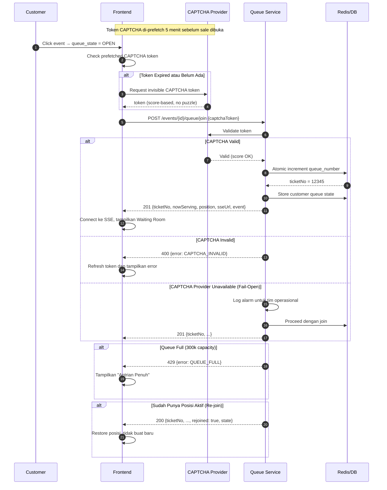

##### SSE Connection dan Event Handling

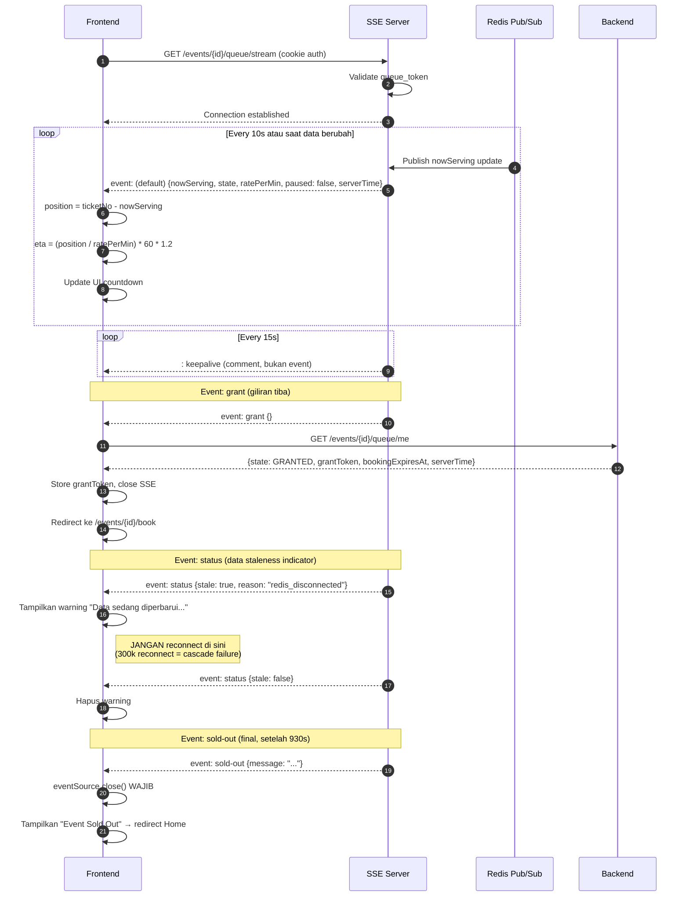

##### Re-entrancy Flow (GET /queue/me)

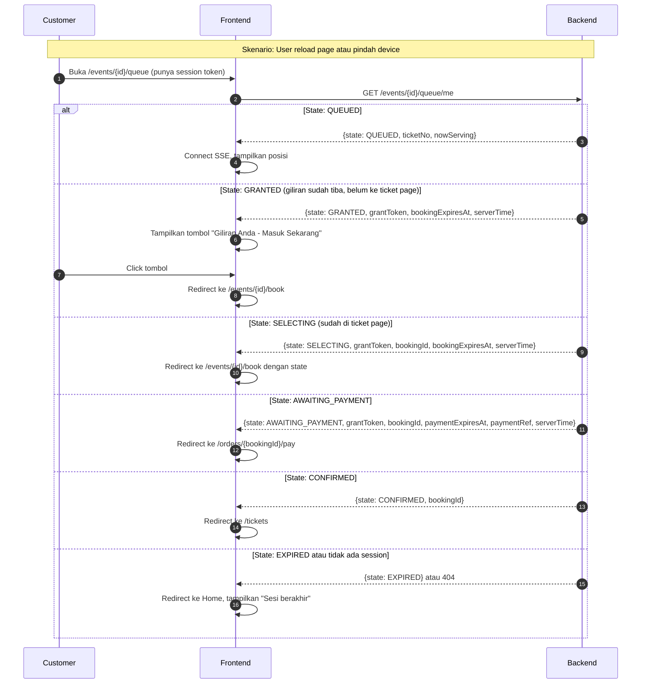

##### Waiting Slot Flow (Position = 0, No Slot Available)

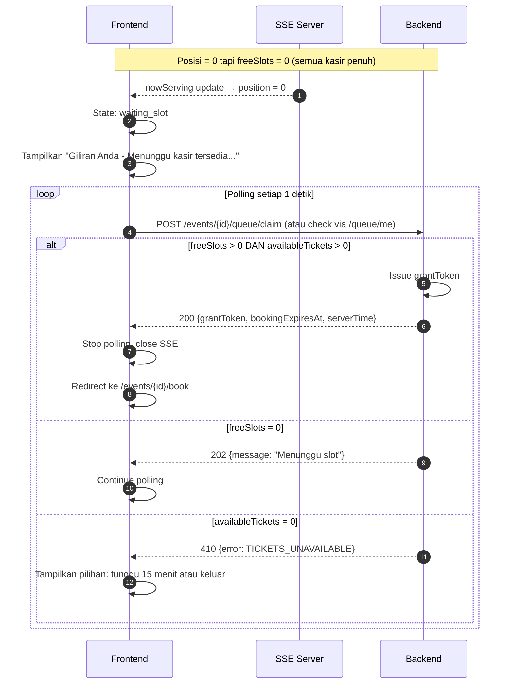

#### Domain Layer

```typescript
// queue/domain/queue-state.model.ts
// Ref: claim-token endpoint REMOVED in v2.0 (ADR-005 Appendix C #1)
// Grant is now pushed via SSE 'grant' event; access_token fetched from GET /queue/me

export type WaitingRoomState =
  | {
      status: 'waiting';
      eventName: string;
      position: number;
      joinedPosition: number; // Initial position for progress bar
      etaSeconds: number;
      ratePerMin: number;
      paused: boolean;        // ❌ DIHAPUS (ADR-006 §4.3): field tetap ada untuk backward compat, selalu false
    }
  | {
      status: 'granted';      // 'grant' SSE event received; fetching access_token
      eventName: string;
    }
  | {
      status: 'admitted';
      eventName: string;
      accessToken: string;
      bookingExpiresAt: string;
      serverTime: string;
    }
  | {
      status: 'sold_out_temporary'; // state: SOLD_OUT on SSE — reversible, stay connected
      eventName: string;
      position: number;
    }
  | {
      status: 'sold_out_final';     // 'sold-out' SSE event — MUST close stream
      eventName: string;
    };
```

```typescript
// queue/domain/queue.protocol.ts
export interface QueueProtocol {
  joinQueue(eventId: string, captchaToken: string): Promise<QueueJoinResult>; // POST /events/{id}/queue/join
  getMyQueueState(eventId: string): Promise<CustomerQueueState>;              // GET /events/{id}/queue/me (re-entrancy)
  getNowServing(eventId: string): Promise<NowServingResult>;                  // GET /events/{id}/queue/serving (polling fallback)
  cancelQueue(eventId: string): Promise<void>;                               // implicit on leave
  // NOTE: claimToken REMOVED (ADR-005 v2.0) — grant pushed via SSE, access_token fetched from getMyQueueState
}

export type QueueJoinResult = {
  ticketNo: number;
  nowServing: number;
  position: number;
  estimatedWaitMinutes: number;
  sseUrl: string;
  rejoined?: boolean;
  state?: CustomerStateValue; // If rejoined and already past QUEUED
};

// State of THIS customer (from GET /queue/me)
export type CustomerStateValue = 'QUEUED' | 'GRANTED' | 'SELECTING' | 'AWAITING_PAYMENT' | 'CONFIRMED' | 'EXPIRED';

export type CustomerQueueState =
  | { state: 'QUEUED'; ticketNo: number; nowServing: number }
  | { state: 'GRANTED'; accessToken: string; bookingExpiresAt: string; serverTime: string }
  | { state: 'SELECTING'; accessToken: string; bookingId: string; bookingExpiresAt: string; serverTime: string }
  | { state: 'AWAITING_PAYMENT'; accessToken: string; bookingId: string; paymentExpiresAt: string; paymentRef: string; serverTime: string }
  | { state: 'CONFIRMED'; bookingId: string }
  | { state: 'EXPIRED' };

export type NowServingResult = {
  nowServing: number;
  ratePerMin: number;
  paused: boolean;
  serverTime: string;
  pollAfterMs: number; // Server-driven interval (10s/5s/2s/1s based on position)
};

// queue/domain/queue-updates.protocol.ts
// SSE stream: GET /events/{eventId}/queue/stream
// Auth: cookie queue_token (web) or Authorization header (mobile) — NEVER query string

export type QueueSsePayload = {
  nowServing: number;
  state: 'SCHEDULED' | 'OPEN' | 'SOLD_OUT' | 'CLOSED'; // Sale lifecycle
  ratePerMin: number;  // For ETA calculation (BR-11)
  paused: boolean;     // ❌ DIHAPUS (ADR-006 §4.3): selalu false, tidak ada pause admission
  serverTime: string;  // ISO-8601 — client syncs clock offset (BR-10)
};

// Event: grant (empty payload) — giliran customer tiba, access_token di GET /queue/me
export type GrantSseEvent = Record<never, never>;

// Event: status — data STALENESS indicator (NOT queue status, NOT connection status)
export type StatusSseEvent = {
  stale: boolean;
  reason: 'redis_disconnected' | 'no_admission_updates';
};

// Event: sold-out — sale permanently closed; client MUST call eventSource.close()
export type SoldOutSseEvent = { message: string };

export interface QueueUpdatesProtocol {
  subscribe(
    eventId: string,
    observer: Observer<QueueSsePayload>,
    onGrant: () => void,        // Fired on 'grant' event → call getMyQueueState
    onStalenessChange: (event: StatusSseEvent) => void,
    onSoldOut: () => void       // MUST call eventSource.close() here
  ): Unsubscribe;
}
```

```typescript
// queue/domain/queue-progress.rules.ts
export const ETA_BUFFER_MULTIPLIER = 1.2; // +20% buffer (BR-11)

export function calculatePosition(
  queueNumber: number, 
  nowServing: number
): number {
  return Math.max(0, queueNumber - nowServing);
}

export function calculateEta(
  position: number,
  avgProcessingRatePerMinute: number
): number {
  const baseEta = (position / avgProcessingRatePerMinute) * 60;
  return Math.ceil(baseEta * ETA_BUFFER_MULTIPLIER);
}
```

#### Application Layer

```typescript
// queue/application/watch-queue-state.use-case.ts
export type WatchQueueStateUseCase = (eventId: string, observer: Observer<QueueState>) => Unsubscribe;

export function createWatchQueueStateUseCase({
  queueUpdatesService,
}: {
  queueService: QueueProtocol;
  queueUpdatesService: QueueUpdatesProtocol;
}): WatchQueueStateUseCase {
  return (eventId, observer) =>
    queueUpdatesService.subscribe(eventId, (update) => {
      // Recalculate position based on nowServing
      observer.next(/* recalculated state */);
    });
}
```

```typescript
// queue/application/join-queue-with-captcha.use-case.ts
export type JoinQueueWithCaptchaUseCase = (eventId: string) => Promise<QueueJoinResult>;

export function createJoinQueueWithCaptchaUseCase({
  queueService,
  captchaService,
}: {
  queueService: QueueProtocol;
  captchaService: CaptchaProtocol;
}): JoinQueueWithCaptchaUseCase {
  return async (eventId) => {
    // Token prefetched before sale_starts_at (Req 3.22); refresh on failure
    const captchaToken = await captchaService.prefetchToken();
    return queueService.joinQueue(eventId, captchaToken);
  };
}
```

```typescript
// queue/application/get-customer-queue-state.use-case.ts
// Ref: BR-09 re-entrancy — GET /events/{id}/queue/me
// Called on: page load, SSE 'grant' event, when 'paused' changes on SSE payload
export type GetCustomerQueueStateUseCase = (eventId: string) => Promise<CustomerQueueState>;

export function createGetCustomerQueueStateUseCase({
  queueService,
}: {
  queueService: QueueProtocol;
}): GetCustomerQueueStateUseCase {
  return (eventId) => queueService.getMyQueueState(eventId);
}
```

---

### Module: booking

**Purpose**: Pemilihan tiket, validasi NIK per attendee, dan identitas pemesan.

#### Booking Module Flow Diagrams

##### Ticket Selection dan NIK Validation Flow

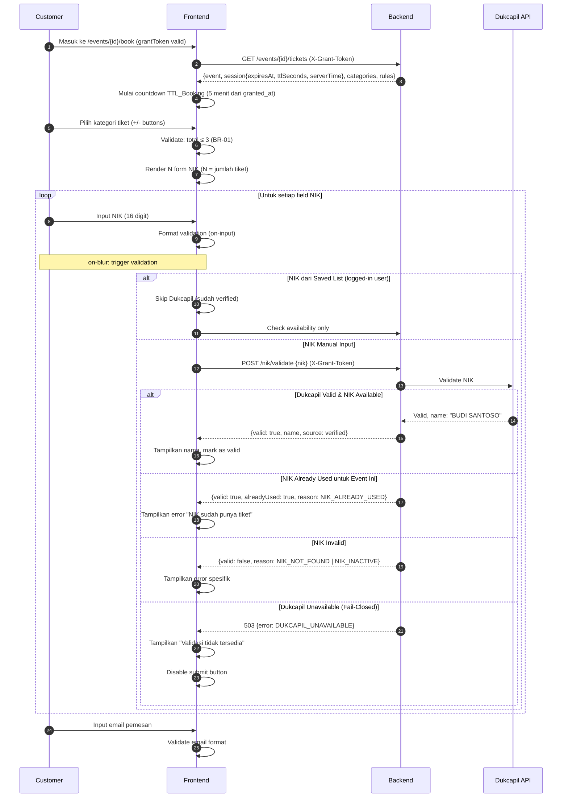

##### Submit Booking Flow (Atomic Hold)

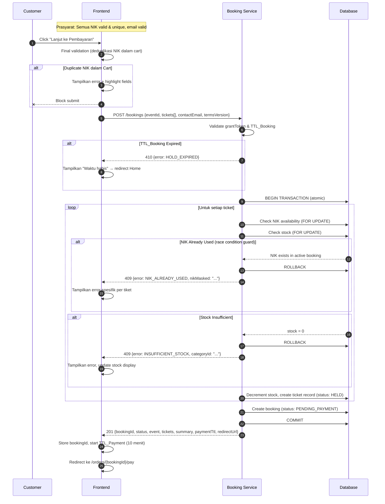

##### Stock Refresh Flow (Polling 15s)

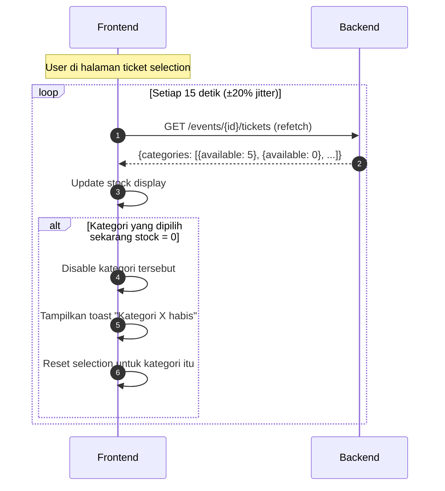

##### Replace Hold Flow (Ubah Pilihan Tiket)

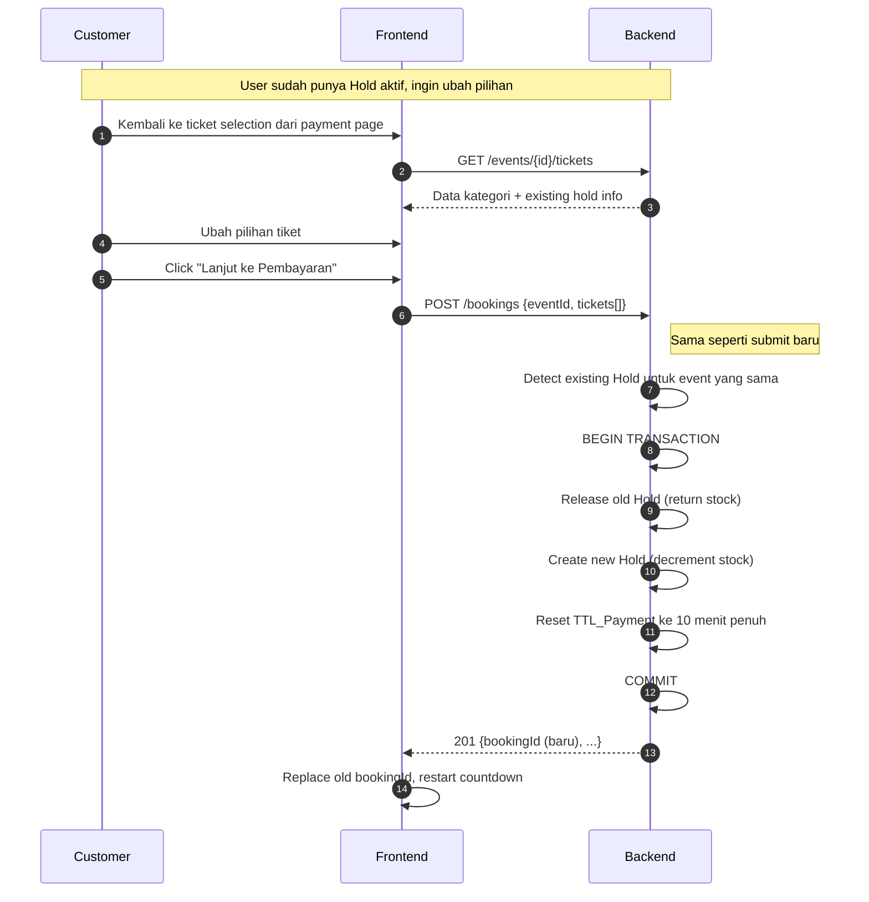

#### Domain Layer

```typescript
// booking/domain/booking-session.model.ts
// Source: GET /events/{event_id}/tickets (replaces /events/{id}/booking/session)
export type TicketCategory = {
  id: string;
  name: string;
  description: string;
  priceIdr: number;
  available: number;         // 0 = habis
  maxPerOrder: number;       // 0 if sold out
};

export type BookingRules = {
  maxTicketsPerOrder: number; // 3 (BR-01)
  oneNikPerTicket: boolean;   // true (BR-02)
};

export type BookingSession = {
  event: {
    id: string;
    name: string;
    date: string;
    venue: string;
    imageUrl: string;
  };
  session: {
    expiresAt: string;   // Server timestamp (ADR-0005)
    ttlSeconds: number;  // Remaining seconds
    serverTime: string;  // For clock offset calculation
  };
  categories: TicketCategory[];
  rules: BookingRules;
};
```

```typescript
// booking/domain/attendee.model.ts
export type AttendeeInfo = {
  ticketIndex: number;
  categoryId: string;
  nik: string;
  holderEmail: string;         // Per-ticket email (FR-26: e-ticket delivered to each holder)
  nikSource: 'manual' | 'self' | 'saved'; // 'friend' renamed to 'saved' (saved-niks)
  nikValidationStatus: 'pending' | 'valid' | 'invalid' | 'already_used';
  // 'already_used' is INDICATIVE (not a reservation) — real enforcement is atomic at POST /bookings
};

export type BookingFormState = {
  attendees: AttendeeInfo[];
  contactEmail: string;       // Renamed from buyerEmail (matches API field: contact_email)
  emailValid: boolean;
};
```

```typescript
// booking/domain/booking.protocol.ts
export interface BookingProtocol {
  getSession(eventId: string): Promise<BookingSession>;          // GET /events/{id}/tickets
  validateNik(nik: string): Promise<NikValidationResult>;        // POST /nik/validate
  submitBooking(data: BookingSubmitData): Promise<BookingResult>; // POST /bookings
  getBooking(bookingId: string): Promise<BookingDetail>;         // GET /bookings/{id}
  // NOTE: separate stock endpoint REMOVED — stock comes with getSession and polling refetch
  // NOTE: quota endpoint REMOVED — quota enforced server-side atomically
}

export type NikValidationResult =
  | { valid: true; source: 'registered' | 'saved' | 'verified' }
  | { valid: true; alreadyUsed: true; reason: 'NIK_ALREADY_USED' }
  | { valid: false; reason: 'NIK_NOT_FOUND' | 'NIK_INACTIVE' | 'DUKCAPIL_UNAVAILABLE' };

// Fail-closed: DUKCAPIL_UNAVAILABLE blocks booking, not fallback (ADR-005 §8)

export type BookingSubmitData = {
  eventId: string;
  tickets: Array<{
    categoryId: string;
    nik: string;
    holderEmail: string; // Per-ticket (FR-26)
  }>;
  contactEmail: string;  // Overall contact
  termsVersion: string;
};

export type BookingResult = {
  bookingId: string;
  status: 'PENDING_PAYMENT';
  paymentTtl: { expiresAt: string; ttlSeconds: number; serverTime: string };
  redirectUrl: string;
};

export type BookingDetail = {
  bookingId: string;
  status: 'PENDING_PAYMENT' | 'PAID' | 'EXPIRED' | 'CANCELLED';
  event: { id: string; name: string; date: string; venue: string };
  tickets: Array<{ category: string; priceIdr: number; nikMasked: string; ticketId?: string; eticketUrl?: string }>;
  summary: { quantity: number; total: number };
  paymentTtl?: { expiresAt: string; ttlSeconds: number; serverTime: string };
  paidAt?: string;
  paymentMethod?: string;
};
```

```typescript
// booking/domain/booking.constants.ts
/** BR-01: maksimal tiket per transaksi */
export const MAX_TICKETS_PER_TRANSACTION = 3;

/** BR-03: TTL_Booking dalam detik */
export const TTL_BOOKING_SECONDS = 300; // 5 menit

/** Interval refresh stok (ADR-0004) */
export const STOCK_REFRESH_INTERVAL_MS = 15_000;

/** ❌ DIHAPUS (ADR-006 §4.3): BR-22 tidak berlaku lagi — tenggat tidak pernah digeser */
// export const PAUSE_TTL_GRACE_SECONDS = 60; // DEPRECATED
```

```typescript
// booking/domain/can-add-ticket.rules.ts
import { MAX_TICKETS_PER_TRANSACTION } from './booking.constants';

export function canAddTicket(
  currentCount: number,
  stock: number
): boolean {
  return currentCount < MAX_TICKETS_PER_TRANSACTION && stock > 0;
}

export function validateTicketSelection(
  selection: Map<string, number>,
  categories: TicketCategory[]
): ValidationResult {
  const totalTickets = Array.from(selection.values())
    .reduce((sum, qty) => sum + qty, 0);
    
  if (totalTickets > MAX_TICKETS_PER_TRANSACTION) {
    return { valid: false, error: 'EXCEEDS_MAX_TICKETS' };
  }
  
  for (const [categoryId, qty] of selection) {
    const category = categories.find(c => c.id === categoryId);
    if (!category || category.stock < qty) {
      return { valid: false, error: 'INSUFFICIENT_STOCK', categoryId };
    }
  }
  
  return { valid: true };
}
```

```typescript
// booking/domain/nik-dedup.rules.ts
export function findDuplicateNiks(niks: string[]): string[] {
  const seen = new Set<string>();
  const duplicates: string[] = [];
  
  for (const nik of niks) {
    if (seen.has(nik)) {
      duplicates.push(nik);
    }
    seen.add(nik);
  }
  
  return duplicates;
}

export function validateNikUniqueness(
  niks: string[]
): { valid: boolean; duplicates: string[] } {
  const duplicates = findDuplicateNiks(niks);
  return {
    valid: duplicates.length === 0,
    duplicates
  };
}
```

```typescript
// booking/domain/selection.reducer.ts
export type SelectionState = {
  quantities: Map<string, number>;
  totalTickets: number;
};

export type SelectionAction =
  | { type: 'INCREMENT'; categoryId: string }
  | { type: 'DECREMENT'; categoryId: string }
  | { type: 'SET'; categoryId: string; quantity: number }
  | { type: 'RESET' };

export function selectionReducer(
  state: SelectionState,
  action: SelectionAction
): SelectionState {
  // Pure reducer logic
}
```

#### Application Layer

```typescript
// booking/application/submit-booking.use-case.ts
export type SubmitBookingUseCase = (data: BookingSubmitData) => Promise<BookingResult>;

export function createSubmitBookingUseCase({ bookingService }: { bookingService: BookingProtocol }): SubmitBookingUseCase {
  return async (data) => {
    // Validasi NIK uniqueness (frontend validation)
    const nikValidation = validateNikUniqueness(data.attendees.map((a) => a.nik));

    if (!nikValidation.valid) {
      return {
        success: false,
        error: 'DUPLICATE_NIK_IN_REQUEST',
        duplicates: nikValidation.duplicates,
      };
    }

    // Submit to backend (atomic hold)
    return bookingService.submitBooking(data);
  };
}
```

---

### Module: payment

**Purpose**: Proses pembayaran dengan VA dan GoPay via Midtrans Core API.

#### Payment Module Flow Diagrams

##### Payment State Machine Transitions

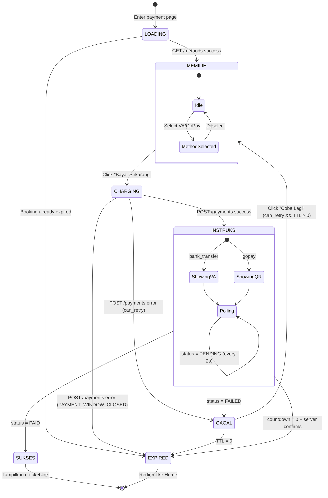

##### Payment Initiation dan Polling Flow

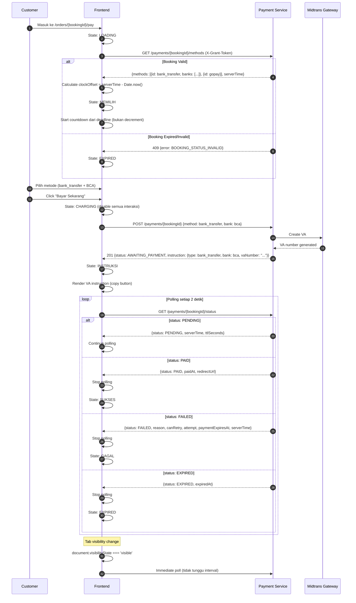

##### Retry/Change Payment Method Flow

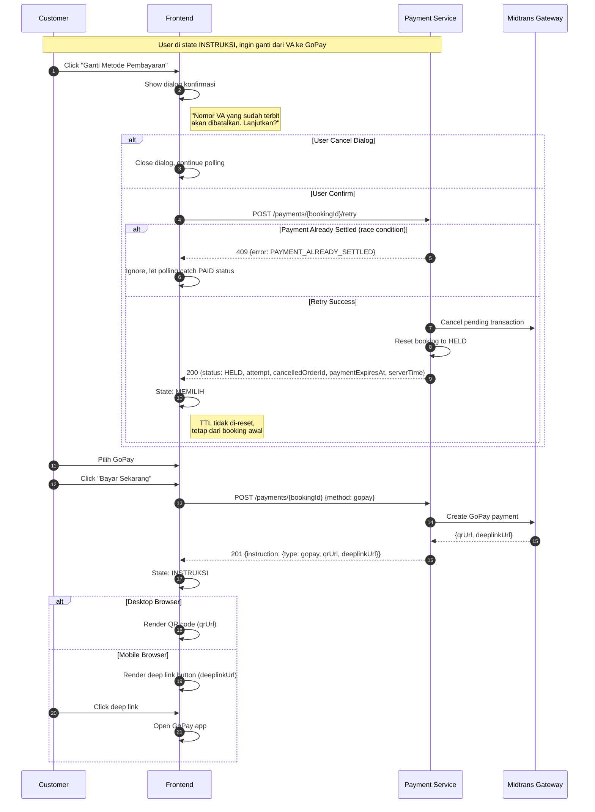

##### Payment Failed → Retry Flow

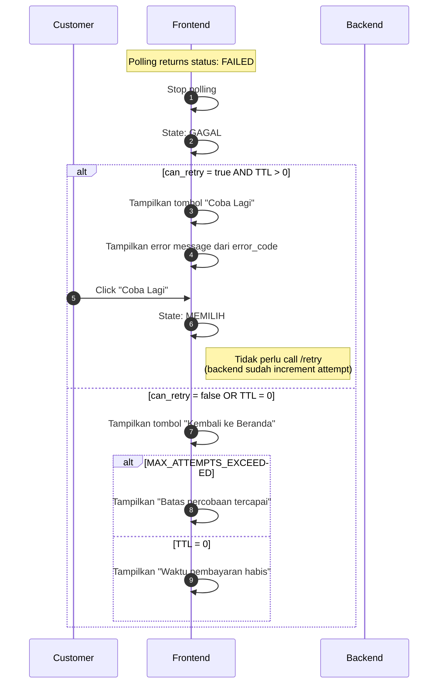

##### Countdown dan Clock Synchronization

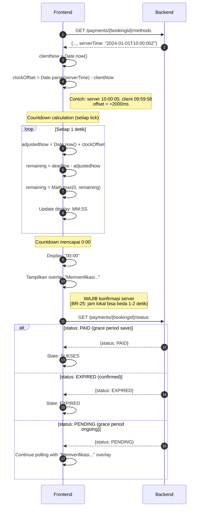

#### Domain Layer

```typescript
// payment/domain/order.model.ts
// Source: POST /payments/{booking_id} response

export type PaymentMethod = 'bank_transfer' | 'gopay'; // bank_transfer = VA (BCA/BNI/BRI/CIMB)

export type BankCode = 'bca' | 'bni' | 'bri' | 'cimb';

export type PaymentInstruction =
  | { type: 'bank_transfer'; bank: BankCode; vaNumber: string }  // VA number only; expiry = payment TTL
  | { type: 'gopay'; qrUrl: string; deeplinkUrl: string };       // Desktop: qrUrl; mobile: deeplinkUrl

export type AvailableMethod = {
  id: PaymentMethod;
  name: string;
  description: string;
  iconUrl: string;
  enabled: boolean;                          // false when breaker OPEN
  banks?: Array<{ code: BankCode; name: string; iconUrl: string }>; // Only for bank_transfer
};

// Payment status from GET /payments/{id}/status polling
export type PaymentStatusResult =
  | { status: 'PENDING'; serverTime: string; ttlSeconds: number }
  | { status: 'PAID'; paidAt: string; redirectUrl: string }
  | { status: 'FAILED'; reason: string; canRetry: boolean; attempt: number; paymentExpiresAt: string; serverTime: string }
  | { status: 'EXPIRED'; expiredAt: string };

export type OrderStatus =
  | 'PENDING_PAYMENT'   // booking status: customer hasn't paid yet
  | 'AWAITING_PAYMENT'  // payment initiated, waiting gateway confirmation
  | 'PENDING_CANCELLATION' // TTL expired, grace period (show "verifying...")
  | 'PAID'
  | 'FAILED'
  | 'EXPIRED';

export type OrderItem = {
  category: string;
  priceIdr: number;
  nikMasked: string;
};

export type Order = {
  bookingId: string;
  eventName: string;
  items: OrderItem[];
  totalIdr: number;
  paymentTtl: { expiresAt: string; ttlSeconds: number; serverTime: string };
  status: OrderStatus;
  method?: PaymentMethod;
  instruction?: PaymentInstruction;
  attempt?: number;
};
```

```typescript
// payment/domain/payment.constants.ts
/** BR-05: TTL_Pembayaran dalam detik — starts from POST /bookings, not from page open */
export const TTL_PAYMENT_SECONDS = 600; // 10 menit

/** BR-10: Grace period dalam detik */
export const GRACE_PERIOD_SECONDS = 30;

/** Polling interval for payment status (no SSE for payment) */
export const PAYMENT_STATUS_POLL_INTERVAL_MS = 3_000;

/** Minimum remaining TTL to allow method switch (PAYMENT_WINDOW_CLOSED guard) */
export const MIN_RETRY_REMAINING_SECONDS = 60;
```

```typescript
// payment/domain/order.rules.ts
export function isFinalOrder(order: Order): boolean {
  return order.status === 'PAID' || order.status === 'FAILED' || order.status === 'EXPIRED';
}

// Ganti metode: cancel pending → POST /payments/{id}/retry → POST /payments/{id} with new method
// Can retry when booking is HELD with prior attempt (payment_status: FAILED from polling)
export function canRetryPayment(status: PaymentStatusResult['status']): boolean {
  return status === 'FAILED';
}

// Can initiate new payment when booking is HELD (before any attempt, or after deny/cancel)
export function canInitiatePayment(order: Order): boolean {
  return order.status === 'PENDING_PAYMENT';
}
```

```typescript
// payment/domain/order.protocol.ts
export interface OrderProtocol {
  getOrder(bookingId: string): Promise<Order>;                                   // GET /bookings/{id}
  getAvailableMethods(bookingId: string): Promise<AvailableMethod[]>;            // GET /payments/{id}/methods
  initiatePayment(bookingId: string, method: PaymentMethod, bank?: BankCode): Promise<Order>; // POST /payments/{id}
  retryPayment(bookingId: string): Promise<Order>;                               // POST /payments/{id}/retry (cancel & switch)
  getPaymentStatus(bookingId: string): Promise<PaymentStatusResult>;             // GET /payments/{id}/status
}

// NOTE: OrderUpdatesProtocol (SSE) REMOVED for payment
// Payment status uses polling only — audience is 1 person, not 300k (see Appendix B)
// NOTE: changePaymentMethod use case REMOVED — replaced by retryPayment flow:
//   1. Call retryPayment() → cancels pending transaction → booking returns to HELD
//   2. Call initiatePayment() with new method
```

```typescript
// payment/application/change-payment-method.use-case.ts REMOVED
// Replaced by retryPayment flow: retryPayment() → initiatePayment() with new method
```

#### Views Layer

Following ADR-0022 — Composable Instruction Renderer. `PaymentView` delegates rendering of each instruction type to a dedicated component via a registry. The controller and mapper never contain `switch`/`if` over `instruction.type`.

```typescript
// payment/views/renderers/renderer.registry.ts
import type { ComponentType } from "react";
import type { PaymentInstruction, PaymentMethod } from "../../domain/order.model";

export type InstructionRendererProps = {
  instruction: PaymentInstruction;
  copied: boolean;         // VA: has number been copied
  onCopy: (text: string) => void;
  isEmbedded: boolean;     // true when rendered inside WebView (ADR-007)
};

export type InstructionRendererRegistry = {
  [K in PaymentMethod]: ComponentType<InstructionRendererProps>;
};

// Registry — adding a new payment method = one new file + one line here
export const instructionRenderers: InstructionRendererRegistry = {
  bank_transfer: BankTransferInstructionView,  // VA number + copy button (Signal DS)
  gopay: GoPayInstructionView,                  // QR (desktop) or deeplink (mobile/WebView)
};
```

**`isEmbedded` source**: set by `app/(embed)` layout — NEVER by `navigator.userAgent`. This ensures the WebView-specific render path is determined at the routing layer, not in component logic.

```typescript
// payment/views/PaymentView.tsx — delegate to registry, no switch
const InstructionRenderer = props.instruction
  ? instructionRenderers[props.instruction.type]
  : null;

return InstructionRenderer ? (
  <InstructionRenderer
    instruction={props.instruction}
    copied={props.copied}
    onCopy={props.onCopy}
    isEmbedded={props.isEmbedded}
  />
) : null;
```

File structure (ADR-0022):
```
payment/views/
├── PaymentView.tsx             ← orchestrator; no instruction.type branching
├── PaymentResultView.tsx
└── renderers/
    ├── renderer.registry.ts   ← InstructionRendererProps + registry
    ├── BankTransferInstructionView.tsx   ← Card + VA number + copy (Signal DS)
    └── GoPayInstructionView.tsx          ← QR url (desktop) | deeplink (mobile)
```

#### WebView Payment Integration (ADR-007)

Sesuai ADR-007, halaman pembayaran dapat diakses melalui WebView dari aplikasi mobile. Integrasi ini menggunakan mekanisme Handoff Code untuk serah-terima kredensial secara aman.

##### WebView Payment Flow Diagrams

###### Mobile App → WebView Handoff Flow (Overview)

```mermaid
flowchart TD
    subgraph MOBILE["📱 Mobile App (Native)"]
        M1[Layar Booking Native]
        M2[POST /bookings sukses]
        M3[Request Handoff Code]
        M4[Buka WebView]
        M5[Handle postMessage]
        M6[GET /bookings/{id} konfirmasi]
    end

    subgraph WEBVIEW["🌐 WebView (Payment Page)"]
        W1[Load /m/orders/{id}/pay#code=...]
        W2[Baca #code, hapus dari URL]
        W3[Exchange code → session]
        W4[Payment flow normal]
        W5[postMessage ke app]
    end

    subgraph BACKEND["⚙️ Backend"]
        B1[POST /payments/{id}/handoff]
        B2[POST /payments/handoff/exchange]
        B3[Payment endpoints dengan X-Payment-Session]
    end

    M1 --> M2
    M2 --> M3
    M3 --> B1
    B1 -->|handoff_code + payment_url| M4
    M4 --> W1
    W1 --> W2
    W2 --> W3
    W3 --> B2
    B2 -->|payment_session| W4
    W4 --> B3
    W4 -->|Status change| W5
    W5 --> M5
    M5 --> M6
```

###### Handoff Code Exchange Flow (Detail)

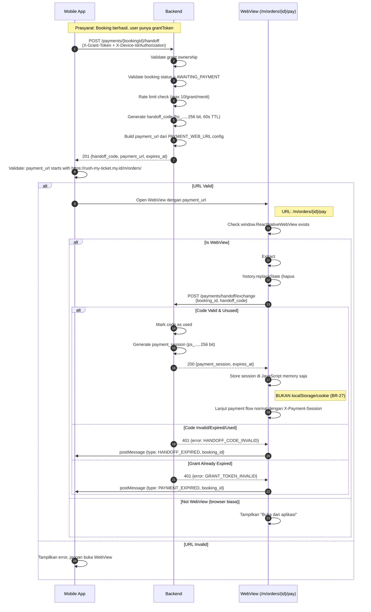

###### postMessage Communication Flow

```mermaid
sequenceDiagram
    autonumber
    participant WV as WebView
    participant App as Mobile App
    participant BE as Backend

    Note over WV,App: Komunikasi via window.ReactNativeWebView.postMessage()

    rect rgb(200, 255, 200)
        Note over WV,App: PAYMENT_DONE - Pembayaran sukses
        WV->>WV: Polling returns status: PAID
        WV->>App: postMessage {type: PAYMENT_DONE, booking_id}
        App->>App: Tutup WebView
        App->>BE: GET /bookings/{booking_id}
        BE-->>App: {status: PAID, ...}
        App->>App: Tampilkan layar tiket
    end

    rect rgb(255, 200, 200)
        Note over WV,App: PAYMENT_EXPIRED - Waktu habis
        WV->>WV: Status: EXPIRED atau countdown habis
        WV->>App: postMessage {type: PAYMENT_EXPIRED, booking_id}
        App->>App: Tutup WebView
        App->>BE: GET /bookings/{booking_id}
        BE-->>App: {status: EXPIRED}
        App->>App: Tampilkan layar kedaluwarsa
    end

    rect rgb(255, 255, 200)
        Note over WV,App: HANDOFF_EXPIRED - Session hilang
        WV->>WV: 401 PAYMENT_SESSION_INVALID<br/>atau page reload
        WV->>App: postMessage {type: HANDOFF_EXPIRED, booking_id}
        App->>BE: POST /payments/{booking_id}/handoff
        BE-->>App: New handoff_code + payment_url
        App->>WV: Reload WebView dengan URL baru
    end

    rect rgb(200, 200, 255)
        Note over WV,App: OPEN_EXTERNAL - GoPay deeplink
        WV->>WV: User pilih GoPay
        WV->>App: postMessage {type: OPEN_EXTERNAL, booking_id, url: "gojek://..."}
        App->>App: Linking.openURL(url)
        Note right of App: WebView tetap terbuka,<br/>polling tetap jalan
        App->>App: User kembali dari GoPay
        App->>BE: GET /bookings/{booking_id} (cek status)
    end

    rect rgb(230, 230, 230)
        Note over WV,App: CLOSE - User minta tutup
        WV->>WV: User click tombol "Kembali"
        WV->>App: postMessage {type: CLOSE, booking_id}
        App->>App: Tutup WebView
        App->>BE: GET /bookings/{booking_id}
        Note right of App: Booking tetap aktif<br/>sampai TTL habis
    end
```

###### WebView Security dan Edge Cases

```mermaid
flowchart TD
    subgraph SECURITY["🔒 Security Controls"]
        S1[originWhitelist: rush-my-ticket.my.id only]
        S2[postMessage: ignore jika origin salah]
        S3[External links: Linking.openURL]
        S4[allowFileAccess: false]
    end

    subgraph EDGE_CASES["⚠️ Edge Cases"]
        E1[Page Reload]
        E2[Network Error]
        E3[401 Session Invalid]
        E4[Race: PAID saat dialog terbuka]
    end

    subgraph HANDLING["✅ Handling"]
        H1[Session hilang → HANDOFF_EXPIRED]
        H2[Retry with backoff, continue polling]
        H3[Stop polling, HANDOFF_EXPIRED]
        H4[Close dialog, transition to SUKSES]
    end

    E1 --> H1
    E2 --> H2
    E3 --> H3
    E4 --> H4

    S1 --> S2
    S2 --> S3
    S3 --> S4
```

##### Domain Layer (WebView Handoff)

```typescript
// payment/domain/webview-handoff.model.ts
// Ref: ADR-007 — Serah-Terima Pembayaran dari Aplikasi Mobile ke WebView

/** Handoff code format: hc_{64 hex characters} */
export type HandoffCode = string;

/** Payment session format: ps_{64 hex characters} */
export type PaymentSession = string;

/** Handoff response dari POST /payments/{booking_id}/handoff */
export type HandoffResult = {
  handoffCode: HandoffCode;
  paymentUrl: string;           // https://{domain}/m/orders/{booking_id}/pay#code={handoff_code}
  expiresAt: string;            // ISO timestamp, ~60 detik dari sekarang
};

/** Exchange response dari POST /payments/handoff/exchange */
export type ExchangeResult = {
  paymentSession: PaymentSession;
  expiresAt: string;            // Sama dengan grant expiry
};

/** Pesan dari WebView ke aplikasi mobile via postMessage */
export type WebViewMessage =
  | { type: 'PAYMENT_DONE'; bookingId: string }
  | { type: 'PAYMENT_EXPIRED'; bookingId: string }
  | { type: 'HANDOFF_EXPIRED'; bookingId: string }
  | { type: 'OPEN_EXTERNAL'; bookingId: string; url: string }
  | { type: 'CLOSE'; bookingId: string };

/** Context untuk mendeteksi apakah halaman diakses via WebView */
export type WebViewContext = {
  isEmbedded: boolean;              // true jika window.ReactNativeWebView ada
  hasHandoffCode: boolean;          // true jika URL fragment mengandung #code=
  paymentSession: string | null;    // disimpan di memori JS, bukan localStorage
};
```

```typescript
// payment/domain/webview-handoff.protocol.ts
// Ref: ADR-007 §5.6, §5.7

export interface WebViewHandoffProtocol {
  /**
   * Request handoff code untuk membuka Payment Page di WebView.
   * Dipanggil oleh aplikasi mobile sebelum membuka WebView.
   * Rate limit: max 10 kode per grant per menit (BR-28).
   * 
   * Headers required: X-Grant-Token + (X-Device-Id untuk guest ATAU Authorization untuk login)
   */
  requestHandoff(bookingId: string): Promise<HandoffResult>;

  /**
   * Tukar handoff code menjadi payment session.
   * Dipanggil oleh halaman web saat pertama kali dimuat di WebView.
   * Handoff code sekali pakai, berlaku 60 detik, terikat ke booking_id.
   * 
   * Errors:
   * - HANDOFF_CODE_INVALID: code sudah digunakan, expired, atau tidak cocok
   * - GRANT_TOKEN_INVALID: grant tidak ada lagi (booking sudah berakhir)
   */
  exchangeHandoffCode(bookingId: string, handoffCode: HandoffCode): Promise<ExchangeResult>;
}
```

```typescript
// payment/domain/webview-handoff.rules.ts
// Ref: ADR-007, BR-27, BR-29, BR-30

/** Regex untuk validasi format handoff code: hc_{64 hex} */
export const HANDOFF_CODE_REGEX = /^hc_[a-f0-9]{64}$/;

/** Regex untuk validasi format payment session: ps_{64 hex} */
export const PAYMENT_SESSION_REGEX = /^ps_[a-f0-9]{64}$/;

/** TTL handoff code dalam detik */
export const HANDOFF_CODE_TTL_SECONDS = 60;

/** Rate limit: max kode per grant per menit */
export const HANDOFF_RATE_LIMIT_PER_MINUTE = 10;

/** Domain yang diizinkan untuk WebView (production) */
export const ALLOWED_WEBVIEW_DOMAIN = 'rush-my-ticket.my.id';

export function isValidHandoffCode(code: string): boolean {
  return HANDOFF_CODE_REGEX.test(code);
}

export function isValidPaymentSession(session: string): boolean {
  return PAYMENT_SESSION_REGEX.test(session);
}

/**
 * Extract handoff code dari URL fragment (#code=hc_...)
 * Fragment tidak dikirim ke server, jadi aman dari logging.
 */
export function extractHandoffCodeFromFragment(): string | null {
  if (typeof window === 'undefined') return null;
  const hash = window.location.hash;
  const match = hash.match(/code=([^&]+)/);
  return match ? match[1] : null;
}

/**
 * Hapus handoff code dari URL menggunakan history.replaceState.
 * Mencegah code bocor di browser history.
 */
export function removeCodeFromUrl(): void {
  if (typeof window === 'undefined') return;
  const url = new URL(window.location.href);
  url.hash = '';
  window.history.replaceState(null, '', url.toString());
}

/**
 * Deteksi apakah halaman dibuka di WebView React Native.
 * TIDAK menggunakan navigator.userAgent karena tidak reliable.
 */
export function isReactNativeWebView(): boolean {
  return typeof window !== 'undefined' && 
         'ReactNativeWebView' in window &&
         typeof (window as any).ReactNativeWebView?.postMessage === 'function';
}

/**
 * Kirim pesan ke aplikasi mobile via postMessage.
 * Pesan hanyalah sinyal — aplikasi HARUS konfirmasi via GET /bookings/{id}.
 */
export function postMessageToApp(message: WebViewMessage): void {
  if (!isReactNativeWebView()) return;
  (window as any).ReactNativeWebView.postMessage(JSON.stringify(message));
}
```

##### Application Layer (WebView Handoff)

```typescript
// payment/application/handle-webview-handoff.use-case.ts
// Ref: ADR-007 — Exchange handoff code dan manage payment session

export type HandleWebViewHandoffUseCase = (bookingId: string) => Promise<WebViewHandoffResult>;

export type WebViewHandoffResult = 
  | { success: true; paymentSession: string }
  | { success: false; error: 'NO_CODE' | 'INVALID_CODE' | 'EXCHANGE_FAILED'; errorCode?: ApiErrorCode };

export function createHandleWebViewHandoffUseCase({
  webViewHandoffService,
}: {
  webViewHandoffService: WebViewHandoffProtocol;
}): HandleWebViewHandoffUseCase {
  return async (bookingId) => {
    // 1. Extract code dari URL fragment
    const handoffCode = extractHandoffCodeFromFragment();
    
    if (!handoffCode) {
      return { success: false, error: 'NO_CODE' };
    }
    
    // 2. Validasi format code
    if (!isValidHandoffCode(handoffCode)) {
      return { success: false, error: 'INVALID_CODE' };
    }
    
    // 3. Hapus code dari URL segera (mencegah bocor di history)
    removeCodeFromUrl();
    
    try {
      // 4. Exchange code untuk payment session
      const result = await webViewHandoffService.exchangeHandoffCode(bookingId, handoffCode);
      
      // 5. Payment session disimpan di memori, BUKAN localStorage (BR-27)
      return { success: true, paymentSession: result.paymentSession };
    } catch (error) {
      const appError = toAppError(error);
      if (appError.kind === 'api') {
        return { success: false, error: 'EXCHANGE_FAILED', errorCode: appError.code };
      }
      return { success: false, error: 'EXCHANGE_FAILED' };
    }
  };
}
```

##### Data Layer (WebView Services)

```typescript
// payment/data/webview-handoff.service.ts
// Implementasi WebViewHandoffProtocol

export function createWebViewHandoffService({
  httpClient,
}: {
  httpClient: HttpClient;
}): WebViewHandoffProtocol {
  return {
    async requestHandoff(bookingId) {
      // POST /payments/{booking_id}/handoff
      // Headers: X-Grant-Token + X-Device-Id atau Authorization
      return httpClient.post(
        `/payments/${bookingId}/handoff`,
        {},
        handoffResultSchema
      );
    },
    
    async exchangeHandoffCode(bookingId, handoffCode) {
      // POST /payments/handoff/exchange
      // Body: { booking_id, handoff_code }
      // Response: { payment_session, expires_at }
      return httpClient.post(
        '/payments/handoff/exchange',
        { booking_id: bookingId, handoff_code: handoffCode },
        exchangeResultSchema
      );
    },
  };
}
```

```typescript
// payment/data/webview-bridge.service.ts
// Service untuk komunikasi WebView ↔ aplikasi mobile

export interface WebViewBridgeService {
  /** Kirim notifikasi pembayaran sukses ke aplikasi */
  notifyPaymentDone(bookingId: string): void;
  
  /** Kirim notifikasi pembayaran expired ke aplikasi */
  notifyPaymentExpired(bookingId: string): void;
  
  /** Kirim notifikasi handoff code expired/invalid, minta kode baru */
  notifyHandoffExpired(bookingId: string): void;
  
  /** Kirim request buka URL external (GoPay deeplink) */
  requestOpenExternal(bookingId: string, url: string): void;
  
  /** Kirim notifikasi close WebView */
  notifyClose(bookingId: string): void;
}

export function createWebViewBridgeService(): WebViewBridgeService {
  return {
    notifyPaymentDone(bookingId) {
      postMessageToApp({ type: 'PAYMENT_DONE', bookingId });
    },
    notifyPaymentExpired(bookingId) {
      postMessageToApp({ type: 'PAYMENT_EXPIRED', bookingId });
    },
    notifyHandoffExpired(bookingId) {
      postMessageToApp({ type: 'HANDOFF_EXPIRED', bookingId });
    },
    requestOpenExternal(bookingId, url) {
      postMessageToApp({ type: 'OPEN_EXTERNAL', bookingId, url });
    },
    notifyClose(bookingId) {
      postMessageToApp({ type: 'CLOSE', bookingId });
    },
  };
}
```

##### Controller Extensions (WebView Context)

```typescript
// payment/controllers/payment-page.controller.ts — WebView extensions
// Ref: ADR-007

export function usePaymentPageController(bookingId: string) {
  // ... existing controller code ...
  
  // WebView context
  const [webViewContext, setWebViewContext] = useState<WebViewContext>({
    isEmbedded: false,
    hasHandoffCode: false,
    paymentSession: null,
  });
  
  const { handleWebViewHandoffUseCase, webViewBridgeService } = useDependencies<PaymentDependencies>();
  
  // Initialize WebView context on mount
  useEffect(() => {
    const isEmbedded = isReactNativeWebView();
    const hasHandoffCode = !!extractHandoffCodeFromFragment();
    
    setWebViewContext(prev => ({ ...prev, isEmbedded, hasHandoffCode }));
    
    // If in WebView with code, handle handoff
    if (isEmbedded && hasHandoffCode) {
      handleWebViewHandoff();
    }
  }, []);
  
  async function handleWebViewHandoff() {
    const result = await handleWebViewHandoffUseCase(bookingId);
    
    if (result.success) {
      // Store payment session in memory only (BR-27)
      setWebViewContext(prev => ({ ...prev, paymentSession: result.paymentSession }));
    } else {
      // Handle errors based on type
      if (result.errorCode === 'HANDOFF_CODE_INVALID') {
        webViewBridgeService.notifyHandoffExpired(bookingId);
      } else if (result.errorCode === 'GRANT_TOKEN_INVALID') {
        webViewBridgeService.notifyPaymentExpired(bookingId);
      } else {
        webViewBridgeService.notifyHandoffExpired(bookingId);
      }
    }
  }
  
  // Handle 401 PAYMENT_SESSION_INVALID on any API call
  function handlePaymentSessionInvalid() {
    webViewBridgeService.notifyHandoffExpired(bookingId);
  }
  
  // Notify app on payment status changes (WebView only)
  useEffect(() => {
    if (!webViewContext.isEmbedded) return;
    
    if (state === 'SUKSES') {
      webViewBridgeService.notifyPaymentDone(bookingId);
    } else if (state === 'EXPIRED') {
      webViewBridgeService.notifyPaymentExpired(bookingId);
    }
  }, [state, webViewContext.isEmbedded]);
  
  // Handle GoPay deeplink in WebView (send to app, not navigate)
  function handleGoPayDeeplink(url: string) {
    if (webViewContext.isEmbedded) {
      webViewBridgeService.requestOpenExternal(bookingId, url);
    } else {
      // Desktop: normal navigation
      window.location.href = url;
    }
  }
  
  return {
    // ... existing returns ...
    webViewContext,
    handleGoPayDeeplink,
    handlePaymentSessionInvalid,
  };
}
```

##### File Structure Update

```
payment/
├── domain/
│   ├── order.model.ts
│   ├── order.protocol.ts
│   ├── order.rules.ts
│   ├── payment.constants.ts
│   ├── payment-page-state.model.ts
│   ├── payment-error.mapper.ts
│   ├── clock-sync.rules.ts
│   ├── webview-handoff.model.ts       ← NEW (ADR-007)
│   ├── webview-handoff.protocol.ts    ← NEW (ADR-007)
│   └── webview-handoff.rules.ts       ← NEW (ADR-007)
├── application/
│   ├── initiate-payment.use-case.ts
│   ├── retry-payment.use-case.ts
│   ├── watch-payment-status.use-case.ts
│   └── handle-webview-handoff.use-case.ts  ← NEW (ADR-007)
├── data/
│   ├── order.service.ts
│   ├── order.schema.ts
│   ├── webview-handoff.service.ts     ← NEW (ADR-007)
│   └── webview-bridge.service.ts      ← NEW (ADR-007)
├── controllers/
│   ├── payment-page.controller.ts     ← EXTENDED for WebView
│   ├── payment-polling.hook.ts
│   ├── payment-focus.hook.ts
│   └── payment-edge-cases.hook.ts
└── views/
    ├── PaymentView.tsx
    ├── PaymentResultView.tsx
    ├── PaymentCountdown.tsx
    ├── PaymentButton.tsx
    └── renderers/
        ├── renderer.registry.ts
        ├── BankTransferInstructionView.tsx
        └── GoPayInstructionView.tsx
```

#### Payment Page State Machine (Requirement 14)

Payment Page menggunakan finite state machine dengan 7 state yang terdefinisi. State machine ini mengatur seluruh transisi UI dan interaksi customer.

```typescript
// payment/domain/payment-page-state.model.ts
export type PaymentPageState =
  | 'LOADING'    // Pertama kali masuk halaman
  | 'MEMILIH'    // Menunggu Customer pilih metode
  | 'CHARGING'   // Sedang membuat transaksi ke gateway
  | 'INSTRUKSI'  // VA/QR sudah terbit
  | 'SUKSES'     // Pembayaran dikonfirmasi
  | 'GAGAL'      // Gateway menolak (deny/cancel/failure)
  | 'EXPIRED';   // TTL + grace habis

export type PaymentPageContext = {
  state: PaymentPageState;
  selectedMethod: PaymentMethod | null;
  instruction: PaymentInstruction | null;
  error: AppError | null;
  canRetry: boolean;
  clockOffset: number;  // Server-client clock difference
  deadline: string;     // ISO timestamp for countdown
};
```

**State Transition Diagram:**

```
LOADING → MEMILIH → CHARGING → INSTRUKSI → SUKSES/GAGAL/EXPIRED
                        ↑            ↓
                        └── GAGAL ───┘ (jika can_retry && TTL > 0)
```

**State Transitions:**

| From | To | Trigger |
|------|----|---------|
| `LOADING` | `MEMILIH` | GET /payments/{id}/methods success |
| `MEMILIH` | `CHARGING` | Customer click "Bayar Sekarang" |
| `CHARGING` | `INSTRUKSI` | POST /payments/{id} success |
| `CHARGING` | `GAGAL` | POST /payments/{id} error (can_retry: true) |
| `CHARGING` | `EXPIRED` | POST /payments/{id} error (PAYMENT_WINDOW_CLOSED) |
| `INSTRUKSI` | `SUKSES` | Polling returns status: PAID |
| `INSTRUKSI` | `GAGAL` | Polling returns status: FAILED |
| `INSTRUKSI` | `EXPIRED` | Polling returns status: EXPIRED OR countdown reaches 0:00 + server confirms |
| `GAGAL` | `MEMILIH` | Customer clicks "Coba Lagi" (if can_retry && TTL > 0) |

#### Payment Page Controller

```typescript
// payment/controllers/payment-page.controller.ts
export function usePaymentPageController(bookingId: string) {
  const { 
    getAvailableMethodsUseCase, 
    initiatePaymentUseCase,
    retryPaymentUseCase,
    watchOrderUseCase,
    clock 
  } = useDependencies<PaymentDependencies>();
  
  const [state, setState] = useState<PaymentPageState>('LOADING');
  const [context, setContext] = useState<PaymentPageContext>(initialContext);
  
  // Clock offset calculation (BR-24, BR-25)
  const [clockOffset, setClockOffset] = useState(0);
  
  // Countdown calculation - MUST use deadline-based, not decrement (BR-24)
  const remaining = useMemo(() => {
    if (!context.deadline) return null;
    const now = clock.now() + clockOffset;
    return Math.max(0, new Date(context.deadline).getTime() - now);
  }, [context.deadline, clockOffset, clock]);
  
  // Polling for payment status (2s interval per Req 14.12)
  const { data: statusData } = useQuery({
    queryKey: paymentKeys.status(bookingId),
    queryFn: () => watchOrderUseCase(bookingId),
    refetchInterval: state === 'INSTRUKSI' ? 2000 : false,
    enabled: state === 'INSTRUKSI',
  });
  
  // Handle countdown reaching 0:00 (BR-25)
  useEffect(() => {
    if (remaining === 0 && state === 'INSTRUKSI') {
      // MUST confirm with server before transitioning to EXPIRED
      confirmExpiry();
    }
  }, [remaining, state]);
  
  // ... state transition handlers
  
  return {
    state,
    context,
    remaining,
    selectMethod,
    submitPayment,
    retryPayment,
    changeMethod,
  };
}
```

#### Clock Synchronization (BR-24, BR-25)

```typescript
// payment/domain/clock-sync.rules.ts
/**
 * Calculate clock offset between server and client.
 * Formula: clockOffset = Date.parse(server_time) - Date.now()
 * 
 * Ref: Req 14.8 — Clock offset dihitung sekali saat halaman dimuat
 */
export function calculateClockOffset(serverTime: string, clientNow: number): number {
  return Date.parse(serverTime) - clientNow;
}

/**
 * Calculate remaining time using deadline-based approach.
 * MUST NOT decrement a counter (tab background causes drift).
 * 
 * Formula: remaining = deadline - (Date.now() + clockOffset)
 * 
 * Ref: Req 14.9 — Countdown dihitung dari deadline, bukan dikurangi
 */
export function calculateRemaining(
  deadline: string,
  clientNow: number,
  clockOffset: number
): number {
  const deadlineMs = Date.parse(deadline);
  const adjustedNow = clientNow + clockOffset;
  return Math.max(0, deadlineMs - adjustedNow);
}
```

#### Polling Strategy

```typescript
// payment/controllers/payment-polling.hook.ts
const POLL_INTERVAL_MS = 2000;  // Req 14.12
const MAX_NETWORK_RETRIES = 3;  // Req 14.13
const RETRY_DELAY_MS = 1000;    // Req 14.13

export function usePaymentPolling(
  bookingId: string,
  enabled: boolean,
  onStatusChange: (status: PaymentStatusResult) => void
) {
  const [consecutiveFailures, setConsecutiveFailures] = useState(0);
  
  const query = useQuery({
    queryKey: paymentKeys.status(bookingId),
    queryFn: async () => {
      try {
        const result = await getPaymentStatus(bookingId);
        setConsecutiveFailures(0);
        return result;
      } catch (error) {
        setConsecutiveFailures(prev => prev + 1);
        throw error;
      }
    },
    refetchInterval: enabled ? POLL_INTERVAL_MS : false,
    retry: MAX_NETWORK_RETRIES,
    retryDelay: RETRY_DELAY_MS,
    // Req 14.13: MUST NOT stop polling on network error
    refetchOnError: true,
  });
  
  // Req 14.14: Immediate poll on tab visibility change
  useEffect(() => {
    const handleVisibility = () => {
      if (document.visibilityState === 'visible' && enabled) {
        query.refetch();
      }
    };
    document.addEventListener('visibilitychange', handleVisibility);
    return () => document.removeEventListener('visibilitychange', handleVisibility);
  }, [enabled, query]);
  
  // Show toast after 3 consecutive failures (Req 14.13)
  const isDisconnected = consecutiveFailures >= MAX_NETWORK_RETRIES;
  
  return { ...query, isDisconnected };
}
```

#### Error Handling (Requirement 14.18-14.20)

```typescript
// payment/domain/payment-error.mapper.ts
export const PAYMENT_ERROR_I18N_MAP: Record<string, { id: string; en: string }> = {
  PAYMENT_GATEWAY_UNAVAILABLE: {
    id: 'Sistem Pembayaran Sedang Sibuk. Mohon tunggu beberapa saat dan coba lagi.',
    en: 'Payment System Busy. Please wait a moment and try again.',
  },
  BOOKING_STATUS_INVALID: {
    id: 'Booking Tidak Valid. Status booking Anda telah berubah.',
    en: 'Invalid Booking. Your booking status has changed.',
  },
  PAYMENT_WINDOW_CLOSED: {
    id: 'Waktu Pembayaran Habis. Maaf, waktu untuk menyelesaikan pembayaran telah berakhir.',
    en: 'Payment Time Expired. Sorry, the payment window has closed.',
  },
  MAX_ATTEMPTS_EXCEEDED: {
    id: 'Batas Percobaan Tercapai. Anda telah mencapai batas maksimal percobaan pembayaran.',
    en: 'Maximum Attempts Reached. You have reached the maximum number of payment attempts.',
  },
  PAYMENT_ALREADY_SETTLED: {
    id: 'Pembayaran Sudah Diterima. Pembayaran Anda sedang diproses.',
    en: 'Payment Received. Your payment is being processed.',
  },
  // WebView Payment Handoff errors (ADR-007)
  HANDOFF_CODE_INVALID: {
    id: 'Kode Akses Tidak Valid. Silakan buka kembali halaman pembayaran dari aplikasi.',
    en: 'Invalid Access Code. Please reopen the payment page from the app.',
  },
  PAYMENT_SESSION_INVALID: {
    id: 'Sesi Pembayaran Berakhir. Silakan buka kembali halaman pembayaran dari aplikasi.',
    en: 'Payment Session Expired. Please reopen the payment page from the app.',
  },
  GRANT_TOKEN_INVALID: {
    id: 'Sesi Booking Berakhir. Waktu pembelian Anda telah habis.',
    en: 'Booking Session Expired. Your purchase time has ended.',
  },
  VALIDATION_ERROR: {
    id: 'Permintaan Tidak Valid. Terjadi kesalahan pada permintaan Anda.',
    en: 'Invalid Request. There was an error with your request.',
  },
};

// Req 14.20: BOOKING_STATUS_INVALID near countdown 0 → treat as expired
export function mapPaymentError(
  error: AppError,
  remainingMs: number
): { state: PaymentPageState; message: string } {
  if (error.kind === 'api') {
    // Near expiry + BOOKING_STATUS_INVALID → expired, not generic error
    if (error.code === 'BOOKING_STATUS_INVALID' && remainingMs < 5000) {
      return { state: 'EXPIRED', message: PAYMENT_ERROR_I18N_MAP.PAYMENT_WINDOW_CLOSED.id };
    }
    
    const mapping = PAYMENT_ERROR_I18N_MAP[error.code];
    if (mapping) {
      return { state: 'GAGAL', message: mapping.id };
    }
  }
  
  return { state: 'GAGAL', message: 'Terjadi kesalahan. Silakan coba lagi.' };
}
```

#### Accessibility (Requirement 14.26-14.29)

```typescript
// payment/views/PaymentCountdown.tsx
export function PaymentCountdown({ remaining }: { remaining: number }) {
  const formattedTime = formatCountdown(remaining);
  const announceRef = useRef<HTMLDivElement>(null);
  
  // Req 14.26: Announce significant changes to screen reader
  useEffect(() => {
    if (remaining === 60000) {
      announce('Tersisa 1 menit untuk menyelesaikan pembayaran');
    } else if (remaining === 30000) {
      announce('Tersisa 30 detik untuk menyelesaikan pembayaran');
    } else if (remaining === 0) {
      announce('Waktu pembayaran telah habis');
    }
  }, [remaining]);
  
  return (
    <>
      {/* Req 14.26: role="timer" with aria-live="polite" */}
      <div role="timer" aria-live="polite" aria-atomic="true">
        {formattedTime}
      </div>
      {/* Live region for announcements */}
      <div ref={announceRef} role="status" aria-live="assertive" className="sr-only" />
    </>
  );
}

// payment/views/PaymentButton.tsx
export function PaymentButton({ 
  isLoading, 
  disabled, 
  onClick 
}: PaymentButtonProps) {
  return (
    <Button
      onClick={onClick}
      disabled={disabled || isLoading}
      // Req 14.29: aria-busy and aria-describedby
      aria-busy={isLoading}
      aria-describedby={isLoading ? 'payment-loading-message' : undefined}
    >
      {isLoading ? <Spinner /> : 'Bayar Sekarang'}
      {isLoading && (
        <span id="payment-loading-message" className="sr-only">
          Mohon tunggu, pembayaran sedang diproses
        </span>
      )}
    </Button>
  );
}
```

#### Focus Management (Requirement 14.28)

```typescript
// payment/controllers/payment-focus.hook.ts
export function usePaymentFocusManagement(state: PaymentPageState) {
  const methodSelectRef = useRef<HTMLButtonElement>(null);
  const vaNumberRef = useRef<HTMLDivElement>(null);
  const successButtonRef = useRef<HTMLButtonElement>(null);
  const retryButtonRef = useRef<HTMLButtonElement>(null);
  const homeButtonRef = useRef<HTMLButtonElement>(null);
  
  useEffect(() => {
    // Req 14.28: Manage focus sesuai transisi state
    switch (state) {
      case 'MEMILIH':
        methodSelectRef.current?.focus();
        break;
      case 'INSTRUKSI':
        vaNumberRef.current?.focus();
        break;
      case 'SUKSES':
        successButtonRef.current?.focus();
        break;
      case 'GAGAL':
        retryButtonRef.current?.focus();
        break;
      case 'EXPIRED':
        homeButtonRef.current?.focus();
        break;
    }
  }, [state]);
  
  return {
    methodSelectRef,
    vaNumberRef,
    successButtonRef,
    retryButtonRef,
    homeButtonRef,
  };
}
```

#### Edge Cases (Requirement 14.21-14.25)

```typescript
// payment/controllers/payment-edge-cases.hook.ts

// Req 14.21: Prevent double-click
export function useSubmitGuard() {
  const [isSubmitting, setIsSubmitting] = useState(false);
  
  const guardedSubmit = useCallback(async (submitFn: () => Promise<void>) => {
    if (isSubmitting) return;
    setIsSubmitting(true);
    try {
      await submitFn();
    } finally {
      setIsSubmitting(false);
    }
  }, [isSubmitting]);
  
  return { isSubmitting, guardedSubmit };
}

// Req 14.22, 14.23: Back navigation and tab close warning
export function usePaymentExitWarning(state: PaymentPageState) {
  useEffect(() => {
    if (state !== 'INSTRUKSI') return;
    
    const handleBeforeUnload = (e: BeforeUnloadEvent) => {
      e.preventDefault();
      e.returnValue = '';
    };
    
    window.addEventListener('beforeunload', handleBeforeUnload);
    return () => window.removeEventListener('beforeunload', handleBeforeUnload);
  }, [state]);
}

// Req 14.24: Offline detection
export function useOnlineStatus() {
  const [isOnline, setIsOnline] = useState(navigator.onLine);
  
  useEffect(() => {
    const handleOnline = () => setIsOnline(true);
    const handleOffline = () => setIsOnline(false);
    
    window.addEventListener('online', handleOnline);
    window.addEventListener('offline', handleOffline);
    
    return () => {
      window.removeEventListener('online', handleOnline);
      window.removeEventListener('offline', handleOffline);
    };
  }, []);
  
  return isOnline;
}

// Req 14.25: Token expiry redirect
export function useTokenExpiryHandler(bookingId: string) {
  const router = useRouter();
  
  const handleTokenExpiry = useCallback(() => {
    // Save redirect context
    sessionStorage.setItem('paymentRedirect', `/payments/${bookingId}`);
    router.push('/login');
  }, [bookingId, router]);
  
  return handleTokenExpiry;
}
```

---

### Core Module

**Purpose**: Shared logic yang dipakai lintas modul.

#### Domain Layer

```typescript
// core/domain/app-error.ts
// Aligned with API Contracts Appendix A
export type ApiErrorCode =
  // NIK errors
  | 'NIK_ALREADY_USED'          // NIK sudah digunakan untuk event ini
  | 'NIK_NOT_FOUND'             // NIK tidak terdaftar di Dukcapil
  | 'NIK_INACTIVE'              // NIK terdaftar tapi status tidak aktif
  | 'NIK_VALIDATION_FAILED'     // Validasi NIK ke Dukcapil gagal
  | 'NIK_UNVERIFIED'            // NIK belum lolos POST /nik/validate
  | 'DUKCAPIL_UNAVAILABLE'      // Fail-closed: payment diblokir
  | 'NIK_ALREADY_REGISTERED'    // NIK sudah terikat ke akun lain (global)
  | 'NIK_ALREADY_SAVED'         // NIK sudah ada di saved-niks akun ini
  | 'MAX_SAVED_NIKS_REACHED'    // Saved-niks sudah 5 entri
  // Booking/stock errors
  | 'QTY_EXCEEDED'              // Melebihi 3 tiket per transaksi (BR-01)
  | 'QTY_INVALID'               // Jumlah tiket bukan ≥ 1
  | 'INSUFFICIENT_STOCK'        // Stok tidak mencukupi
  | 'STOCK_UNINITIALIZED'       // 503: kunci stok hilang dari Redis
  | 'STOCK_NEGATIVE'            // 503: guard terakhir menyala
  | 'TICKETS_UNAVAILABLE'       // Tiket sudah habis
  | 'BOOKING_EXPIRED'           // TTL booking habis
  | 'HOLD_EXPIRED'              // Hold sudah expired
  // Payment errors
  | 'PAYMENT_ALREADY_INITIATED' // Charge sudah berjalan; response lama diputar ulang
  | 'PAYMENT_ALREADY_SETTLED'   // Pembayaran lama sudah lunas saat cancel dicoba
  | 'PAYMENT_WINDOW_CLOSED'     // TTL habis atau sisa terlalu pendek untuk ganti metode
  | 'PAYMENT_EXPIRED'           // TTL pembayaran habis
  | 'MAX_ATTEMPTS_EXCEEDED'     // Batas percobaan pembayaran per booking
  | 'BANK_NOT_SUPPORTED'        // Bank di luar bca/bni/bri/cimb
  // Queue errors
  | 'QUEUE_FULL'                // Antrian mencapai kapasitas 300k
  | 'CAPTCHA_REQUIRED'          // captcha_token tidak disertakan
  | 'CAPTCHA_INVALID'           // Token CAPTCHA invalid/expired/used
  | 'ADMISSION_PAUSED'          // ❌ DIHAPUS (ADR-006 §4.3): tidak digunakan, antrian tetap maju
  // Auth errors
  | 'CONSENT_REQUIRED'          // Persetujuan PDP belum diberikan
  | 'TERMS_NOT_ACCEPTED'        // T&C belum diterima
  | 'TOKEN_EXPIRED'             // Access token expired
  | 'TOKEN_INVALID'             // Access token invalid
  | 'TOO_MANY_REQUESTS'         // Rate limited
  // Access errors
  | 'ACCESS_EXPIRED'            // Access token (queue slot) expired
  | 'SLOT_TAKEN_OVER'           // Retain for backward compat (maps to TOKEN_INVALID)
  // WebView Payment Handoff errors (ADR-007)
  | 'HANDOFF_CODE_INVALID'      // Handoff code sudah digunakan, expired (>60 detik), atau tidak cocok dengan booking_id
  | 'PAYMENT_SESSION_INVALID'   // Payment session expired atau grant sudah dihapus
  | 'GRANT_TOKEN_INVALID'       // Grant tidak ada lagi (booking sudah berakhir)
  | 'VALIDATION_ERROR';         // X-Payment-Session dan X-Grant-Token dikirim bersamaan

// REMOVED codes (map to above):
// QUOTA_EXCEEDED → QTY_EXCEEDED
// STOCK_INSUFFICIENT → INSUFFICIENT_STOCK
// QUEUE_TOKEN_INVALID → TOKEN_INVALID
// DUPLICATE_NIK_IN_REQUEST → frontend-only validation, no server code
// INVALID_NIK_FORMAT → 400 without specific code in API contracts
// PAYMENT_METHOD_CHANGE_NOT_ALLOWED → use retryPayment flow instead

export type AppError =
  | { kind: 'api'; code: ApiErrorCode; status: number }
  | { kind: 'network' }
  | { kind: 'invalid_response' }
  | { kind: 'unknown'; status?: number };

export class AppFailure extends Error {
  constructor(readonly error: AppError) {
    super(`AppFailure:${error.kind}`);
    this.name = 'AppFailure';
  }
}
```

```typescript
// core/domain/time/remaining-ms.utils.ts
export function remainingMs(
  expiresAt: string,
  clientNow: number,
  serverOffsetMs: number
): number {
  const expiresAtMs = new Date(expiresAt).getTime();
  const adjustedNow = clientNow + serverOffsetMs;
  return Math.max(0, expiresAtMs - adjustedNow);
}

export function computeServerOffset(
  serverNow: string,
  clientNow: number
): number {
  return new Date(serverNow).getTime() - clientNow;
}
```

```typescript
// core/domain/clock.protocol.ts
export interface ClockProtocol {
  now(): number;
}

// core/domain/random.protocol.ts
export interface RandomProtocol {
  random(): number;
}

// core/domain/captcha.protocol.ts
// Ref: Requirements 3.22, 12.4 — CAPTCHA tak terlihat dengan fail-open behavior
export interface CaptchaProtocol {
  prefetchToken(): Promise<string>;
  refreshToken(): Promise<string>;
  validateToken(token: string): Promise<CaptchaValidationResult>;
}

export type CaptchaValidationResult = {
  valid: boolean;
  score?: number;
  failedOpen?: boolean; // true if provider unavailable (fail-open behavior)
};

// core/domain/captcha.constants.ts
/** Prefetch CAPTCHA token 5 menit sebelum sale dibuka (Req 3.22) */
export const CAPTCHA_PREFETCH_BEFORE_SALE_MS = 300_000;

/** Interval refresh token CAPTCHA */
export const CAPTCHA_REFRESH_INTERVAL_MS = 60_000;

// core/domain/system-state.model.ts
// Ref: ❌ BR-21, BR-22 DIHAPUS (ADR-006 §4.3) — breaker OPEN = fail closed, antrian tetap maju
export type CircuitBreakerState = 'CLOSED' | 'OPEN' | 'HALF_OPEN';

export type SystemHealthState = {
  dukcapilAvailable: boolean;
  paymentGatewayAvailable: boolean;
  admissionPaused: boolean;
  pausedAt?: string; // ISO timestamp when pause started
  dukcapilCircuitBreaker: CircuitBreakerState;
  paymentCircuitBreaker: CircuitBreakerState;
};

// core/domain/system-health.protocol.ts
export interface SystemHealthProtocol {
  getHealthState(): Promise<SystemHealthState>;
}

// core/domain/system-health-updates.protocol.ts
export interface SystemHealthUpdatesProtocol {
  subscribe(observer: Observer<SystemHealthState>): Unsubscribe;
}
```

#### Data Layer

```typescript
// core/data/http/http-client.ts
export interface HttpClient {
  get<T>(path: string, schema: z.ZodType<T>): Promise<T>;
  post<T>(path: string, body: unknown, schema: z.ZodType<T>): Promise<T>;
  delete(path: string): Promise<void>;
}

// core/data/sse/event-stream-client.ts
export interface EventStreamClient {
  connect<T>(
    url: string,
    eventName: string,
    schema: z.ZodType<T>,
    observer: Observer<T>
  ): Unsubscribe;
}
```

#### Controllers Layer

```typescript
// core/controllers/countdown.hook.ts
export function useCountdown(expiresAt: string | null, serverNow: string | null) {
  const { clock } = useDependencies<CoreDependencies>();
  const [remaining, setRemaining] = useState<number | null>(null);
  
  useEffect(() => {
    if (!expiresAt || !serverNow) return;
    
    const offset = computeServerOffset(serverNow, clock.now());
    
    const tick = () => {
      setRemaining(remainingMs(expiresAt, clock.now(), offset));
    };
    
    tick();
    const intervalId = setInterval(tick, 1000);
    
    return () => clearInterval(intervalId);
  }, [expiresAt, serverNow, clock]);
  
  return remaining;
}
```

```typescript
// core/controllers/live-updates.hook.ts
export function useLiveUpdates<T>(
  key: QueryKey,
  subscribe: (observer: Observer<T>) => Unsubscribe,
  enabled: boolean
) {
  const queryClient = useQueryClient();
  const [live, setLive] = useState(false);
  
  useEffect(() => {
    if (!enabled) return;
    
    const unsubscribe = subscribe({
      next: (data) => {
        queryClient.setQueryData(key, data);
      },
      connected: () => setLive(true),
      disconnected: () => setLive(false),
    });
    
    return unsubscribe;
  }, [key, subscribe, enabled, queryClient]);
  
  return { live };
}
```

---

## Data Models

### API Request/Response DTOs

Bentuk request dan response ada di [kontrak API](https://github.com/PTServerJanganTumbang-BookingTicket/documentations/blob/main/api/api-contracts.md) dan [OpenAPI](https://github.com/PTServerJanganTumbang-BookingTicket/documentations/blob/main/api/rusuh-booking-openapi.yaml). Semua response memakai `{ meta: { code, message }, data }` dengan field `snake_case`. Tipe domain FE tetap `camelCase`, dan pemetaannya ada di schema zod `data/<nama>.schema.ts`.

```typescript
// Note: ALL API responses use {meta: {code, message}, data: ...} wrapper
// The HttpClient adapter handles unwrapping — domain models see only data payload

// Event List — GET /events
interface EventListResponse {
  events: Array<{
    id: string;
    name: string;
    date: string;
    imageUrl: string;
    status: 'AVAILABLE' | 'SELLING_OUT_FAST' | 'SOLD_OUT';
    queueState: 'NOT_OPEN' | 'DIRECT' | 'OPEN' | 'FULL';
    queueDepth: number;
    queueCapacity: number;      // 300000
    saleStartsAt: string;       // ISO-8601
    display: {
      enabled: boolean;
      action: 'JOIN_QUEUE' | 'GO_TO_TICKETS' | 'NONE';
      labelKey: string;         // i18n key (not text — FR-32 / multi-language)
      badgeKey: string | null;
    };
    minPrice: number | null;
    maxPrice: number | null;
  }>;
}

// Event Detail — GET /events/{id}
// Includes captcha.site_key for prefetching token before sale_starts_at
interface EventDetailResponse {
  // ... all EventListResponse fields +
  time: string;
  description: string;
  captcha: {
    provider: 'turnstile';
    siteKey: string; // Public key; used to load widget and prefetch token
  };
  ticketCategories: Array<{
    id: string;
    name: string;
    description: string;
    price: number;
    available: number;
    status: 'AVAILABLE' | 'SOLD_OUT';
  }>;
}

// Queue Join — POST /events/{id}/queue/join
interface QueueJoinRequest {
  captchaToken: string; // Required — prefetched before sale_starts_at
}

// Ticket Selection — GET /events/{id}/tickets (requires access_token)
interface TicketSelectionResponse {
  event: { id: string; name: string; date: string; venue: string; imageUrl: string };
  session: {
    expiresAt: string;    // Countdown anchor (ADR-0005, BR-03: from granted_at)
    ttlSeconds: number;   // Remaining
    serverTime: string;   // For clock offset
  };
  categories: Array<{
    id: string;
    name: string;
    description: string;
    price: number;
    available: number;
    maxPerOrder: number;
  }>;
  rules: { maxTicketsPerOrder: 3; oneNikPerTicket: true };
}

// NIK Validation — POST /nik/validate
interface NikValidateRequest { nik: string }
// Success response: {valid: true, source: 'registered'|'saved'|'verified'}
// Already used: {valid: true, alreadyUsed: true, reason: 'NIK_ALREADY_USED'}
// Invalid: {valid: false, reason: 'NIK_NOT_FOUND'|'NIK_INACTIVE'|'DUKCAPIL_UNAVAILABLE'}

// Submit Booking — POST /bookings
interface SubmitBookingRequest {
  eventId: string;
  tickets: Array<{
    categoryId: string;
    nik: string;
    holderEmail: string; // Per-ticket email for e-ticket delivery (FR-26)
  }>;
  contactEmail: string;  // Overall contact
  termsVersion: string;
}

// Payment Methods — GET /payments/{id}/methods
interface PaymentMethodsResponse {
  methods: Array<{
    id: 'bank_transfer' | 'gopay';
    name: string;
    enabled: boolean;
    banks?: Array<{ code: 'bca'|'bni'|'bri'|'cimb'; name: string; iconUrl: string }>;
  }>;
}

// Initiate Payment — POST /payments/{id}
interface InitiatePaymentRequest {
  method: 'bank_transfer' | 'gopay';
  bank?: 'bca' | 'bni' | 'bri' | 'cimb'; // Required for bank_transfer
}
// Response instructions:
// bank_transfer: { bank: 'bca', vaNumber: '8801234567890' }
// gopay: { qrUrl: string, deeplinkUrl: string }  (desktop: qrUrl; mobile: deeplinkUrl)

// Payment Status Poll — GET /payments/{id}/status
// status: 'PENDING' | 'PAID' | 'FAILED' | 'EXPIRED'
// PENDING_CANCELLATION maps to PENDING (show "verifying...", not expired screen)

// API Error Response (meta wrapper)
interface ApiErrorResponse {
  meta: { code: string; message: string };
  data: null;
}
```

### SSE Event Payloads

```typescript
// Queue SSE: GET /events/{eventId}/queue/stream
// Auth: Cookie queue_token (web) | Authorization header (mobile) — NEVER query string

// Default event (unnamed) — on nowServing change, paused change, or every 10s heartbeat
interface QueueDefaultSseEvent {
  nowServing: number;
  state: 'SCHEDULED' | 'OPEN' | 'SOLD_OUT' | 'CLOSED';
  ratePerMin: number;     // For ETA: P/R * 60 * 1.2 (BR-11)
  paused: boolean;        // ❌ DIHAPUS (ADR-006 §4.3): selalu false, tidak ada pause admission
  serverTime: string;     // BR-10: client syncs offset from this
}

// Event: 'grant' — customer's turn arrived; access_token NOT sent via SSE
// Client response: call GET /events/{id}/queue/me to get access_token
interface GrantSseEvent {} // empty payload

// Event: 'status' — DATA staleness indicator (NOT queue status, NOT connection status)
// Sent ONLY on transition; {stale: false} follows when data flows again
// Client MUST NOT reconnect on this — 300k simultaneous reconnects would cascade
interface StatusSseEvent {
  stale: boolean;
  reason: 'redis_disconnected' | 'no_admission_updates';
}

// Event: 'sold-out' — sale PERMANENTLY closed (state: CLOSED, after 930s)
// Client MUST call eventSource.close() — server rejects new connections with 410 Gone
// NOTE: state: SOLD_OUT is NOT this event — SOLD_OUT is reversible (booking expirations)
interface SoldOutSseEvent {
  message: string;
}

// Keepalive: `: keepalive` comment every 15s — NOT a named event, does not trigger handlers

// Payment status: polling only (GET /payments/{id}/status every 3s)
// NO SSE for payment — audience is 1 person, not 300k (see API contracts Appendix B)
```

---

## API Contracts

Daftar lengkap ada di [kontrak API](https://github.com/PTServerJanganTumbang-BookingTicket/documentations/blob/main/api/api-contracts.md). Peta FE saat ini ke kontrak:

| Area | FE saat ini | Kontrak |
|------|-------------|---------|
| Event | `GET /events` | `GET /events`, `GET /events/{event_id}` |
| Antrian | `GET /events/{id}/queue` | `POST …/queue/join`, `GET …/queue/me`, `GET …/queue/serving`, `GET …/queue/stream` |
| Booking | `GET /events/{id}/booking-session` | `GET /events/{event_id}/tickets`, `POST /nik/validate`, `POST /bookings`, `GET /bookings/{booking_id}` |
| Pembayaran | `GET /orders/{id}`, `POST /orders/{id}/payment`, `GET /orders/{id}/stream` | `GET /payments/{booking_id}/methods`, `POST /payments/{booking_id}`, `POST /payments/{booking_id}/retry`, `GET /payments/{booking_id}/status`, `POST /payments/{booking_id}/handoff`, `POST /payments/handoff/exchange` |
| E-tiket | Belum ada | `GET /users/me/tickets`, `GET /tickets/{ticket_id}/eticket` |
| Akun | Belum ada | `/auth/*`, `/accounts/me/saved-niks` |

Endpoint di kontrak saat ini:

| Method | Path | Purpose | Auth | Module |
|--------|------|---------|------|--------|
| POST | `/auth/magic-link` | Request login link via email | - | auth |
| POST | `/auth/magic-link/resend` | Resend login link | - | auth |
| GET | `/auth/verify` | Verify magic link token → set session | Cookie | auth |
| POST | `/auth/register` | Register account (NIK + consent required) | - | auth |
| GET | `/accounts/me/saved-niks` | List saved NIKs (max 5) | Cookie | auth |
| POST | `/accounts/me/saved-niks` | Add NIK to saved list (Dukcapil called here) | Cookie | auth |
| DELETE | `/accounts/me/saved-niks/{id}` | Remove saved NIK | Cookie | auth |
| GET | `/events` | List all events | - | catalog |
| GET | `/events/{event_id}` | Event detail + captcha.site_key | - | catalog |
| POST | `/events/{event_id}/queue/join` | Join queue (captcha_token required) | Cookie | queue |
| GET | `/events/{event_id}/queue/me` | Re-entrancy: get current state + access_token | Cookie | queue |
| GET | `/events/{event_id}/queue/serving` | Now-serving + poll interval (fallback) | Cookie | queue |
| GET | `/events/{event_id}/tickets` | Ticket selection page (categories + session TTL) | AccessToken | booking |
| POST | `/nik/validate` | Validate NIK against Dukcapil (fail-closed) | AccessToken | booking |
| POST | `/bookings` | Submit booking → atomic hold all-or-nothing | AccessToken | booking |
| GET | `/bookings/{booking_id}` | Booking detail (PENDING_PAYMENT / PAID) | Cookie | booking |
| GET | `/payments/{booking_id}/methods` | Available payment methods | AccessToken | payment |
| POST | `/payments/{booking_id}` | Initiate payment (bank_transfer or gopay) | AccessToken | payment |
| POST | `/payments/{booking_id}/retry` | Cancel pending payment → switch method | AccessToken | payment |
| GET | `/payments/{booking_id}/status` | Poll payment status (3s interval) | AccessToken | payment |
| POST | `/payments/{booking_id}/handoff` | Request handoff code for WebView (ADR-007) | GrantToken | payment |
| POST | `/payments/handoff/exchange` | Exchange handoff code → payment session (ADR-007) | - | payment |
| GET | `/users/me/tickets` | My tickets list | Cookie | ticket |
| GET | `/tickets/{ticket_id}/eticket` | E-ticket with QR code | Cookie | ticket |
| GET | `/admin/reconciliation/disputed` | Disputed payments for manual refund | AdminAuth | dashboard |
| GET | `/time` | Server time for clock sync | - | core |

Note: Removed endpoints vs design.md v1:
- `DELETE /events/{eventId}/queue` — cancel is implicit in join flow
- `GET /events/{eventId}/booking/stock` — stock comes with getSession, polled via refetch
- `POST /events/{eventId}/booking/validate-nik` → replaced by `POST /nik/validate`
- `POST /events/{eventId}/booking/submit` → replaced by `POST /bookings`
- `GET /api/quota/{nik}/{eventId}` — quota enforced server-side atomically
- `GET /orders/{orderId}` → replaced by `GET /bookings/{booking_id}`
- `POST /orders/{orderId}/payment` → replaced by `POST /payments/{booking_id}`
- `DELETE /orders/{orderId}/payment` → replaced by `POST /payments/{booking_id}/retry`
- `GET /me/nik-friends` etc → replaced by `/accounts/me/saved-niks`

Katalog error ada di Appendix A kontrak. Contoh response error di kontrak hanya memuat `meta.code` numerik dan `meta.message`, jadi FE belum punya field yang stabil untuk memetakan error ke layar. Ini perlu disepakati dengan BE sebelum integrasi.

---

## State Management

### TanStack Query Configuration

```typescript
// Query client configuration
const queryClient = new QueryClient({
  defaultOptions: {
    queries: {
      staleTime: 0,
      gcTime: 5 * 60 * 1000, // 5 minutes
      retry: 3,
      retryDelay: (attemptIndex) => Math.min(1000 * 2 ** attemptIndex, 30000),
    },
    mutations: {
      retry: 0,
    },
  },
});
```

### Query Keys

```typescript
// catalog/controllers/catalog.queries.ts
export const catalogKeys = {
  all: ['catalog'] as const,
  events: () => [...catalogKeys.all, 'events'] as const,
  event: (eventId: string) => [...catalogKeys.all, 'event', eventId] as const,
};

// queue/controllers/queue.queries.ts
export const queueKeys = {
  all: ['queue'] as const,
  state: (eventId: string) => [...queueKeys.all, 'state', eventId] as const,
};

// booking/controllers/booking.queries.ts
export const bookingKeys = {
  all: ['booking'] as const,
  session: (eventId: string) => [...bookingKeys.all, 'session', eventId] as const,
  stock: (eventId: string) => [...bookingKeys.all, 'stock', eventId] as const,
  quota: (nik: string, eventId: string) => [...bookingKeys.all, 'quota', nik, eventId] as const,
};

// payment/controllers/payment.queries.ts
export const paymentKeys = {
  all: ['payment'] as const,
  order: (orderId: string) => [...paymentKeys.all, 'order', orderId] as const,
};

// core/controllers/system.queries.ts
// Ref: ❌ BR-21, BR-22 DIHAPUS (ADR-006 §4.3) — tidak ada pause admission
export const systemKeys = {
  all: ['system'] as const,
  health: () => [...systemKeys.all, 'health'] as const,
};
```

### Polling Configuration

| Query | Interval | Jitter | Condition |
|-------|----------|--------|-----------|
| Queue state | From server `retryAfterMs` | ±20% | SSE not connected |
| Claim slot (waiting_slot) | 1s | None | Position = 0, no slot available (Req 3 AC3a) |
| Stock refresh | 15s | ±20% | Always |
| Order status | 3s | ±20% | SSE not connected |
| System health | 10s | ±20% | SSE not connected |

### Local State (useReducer)

```typescript
// Ticket selection state
type SelectionState = {
  quantities: Map<string, number>;
  totalTickets: number;
};

// Booking form state
type BookingFormState = {
  attendees: AttendeeInfo[];
  buyerEmail: string;
  validation: ValidationState;
};

// UI state (modals, dialogs)
type UIState = {
  showCancelDialog: boolean;
  showExitDialog: boolean;
};
```

---

## Correctness Properties

*A property is a characteristic or behavior that should hold true across all valid executions of a system—essentially, a formal statement about what the system should do. Properties serve as the bridge between human-readable specifications and machine-verifiable correctness guarantees.*

### Property 1: NIK Format Validation

*For any* input string, the system SHALL accept it as a valid NIK if and only if it consists of exactly 16 numeric digits.

**Validates: Requirements 0.2, 10.6, 10.7**

### Property 2: NIK Uniqueness Within Transaction

*For any* array of NIK entries in a booking form, if there exist two entries with the same NIK value, the form validation SHALL fail and identify all duplicate NIKs.

**Validates: Requirements 0.6, 4.6**

### Property 3: Ticket Count Equals NIK Form Count

*For any* ticket selection where N tickets are selected (1 ≤ N ≤ 3), the booking form SHALL render exactly N NIK input fields, one for each attendee.

**Validates: Requirements 0.5, 4.5**

### Property 4: Event Status to UI State Mapping

*For any* event with display block from server, the UI SHALL render the event as enabled if `display.enabled` is true, and disabled otherwise, without computing status precedence locally.

**Validates: Requirements 1.2, 1.3, 1.7**

### Property 5: Queue Position Display Format

*For any* queue state with position N where N > 0, the UI SHALL display "Anda antrian ke-{N}" exactly as calculated from `queueNumber - nowServing`.

**Validates: Requirements 3.1, 3.18**

### Property 6: Estimated Wait Time Buffer

*For any* average processing rate R and queue position P, the estimated wait time SHALL be at least P/R × 1.2 (20% buffer applied).

**Validates: Requirements 3.8, BR-11**

### Property 7: Category Disabled When Stock Zero

*For any* ticket category with stock equal to 0, the category selection UI SHALL be disabled and unclickable.

**Validates: Requirements 4.3, 4.12**

### Property 8: Total Ticket Limit Enforcement

*For any* ticket selection attempt that would result in more than 3 total tickets, the increment action SHALL be blocked and the submit button SHALL be disabled.

**Validates: Requirements 4.4, BR-01**

### Property 9: Email Format Validation

*For any* input string in the buyer email field, validation SHALL pass if and only if the string contains at least one `@` character followed by a domain with at least one `.` character.

**Validates: Requirements 4.13**

### Property 10: Server-Synced Countdown Calculation

*For any* server timestamp `expiresAt` and computed offset, the countdown displayed SHALL equal `max(0, expiresAt - (clientNow + offset))` in milliseconds, recalculated every tick.

**Validates: Requirements 5.1, 5.2, 5.3, 6.1**

### Property 11: Payment Instruction Type Mapping

*For any* payment instruction from server, the UI SHALL render the appropriate payment UI component based on instruction type: VA number for `virtual_account`, QR code for `qr`, deep link for `deeplink`.

**Validates: Requirements 6.3, 6.11**

### Property 12: Error Code to i18n Mapping

*For any* API error code returned by backend, the controller SHALL map it to a localized message key, and the view SHALL display the translated message in the current language.

**Validates: Requirements 4.16, 13.5**

### Property 13: Language Toggle Consistency

*For any* language selection (ID or EN), all UI text elements on the current page SHALL be rendered in the selected language without mixing.

**Validates: Requirements 13.2, 13.3**

### Property 14: ~~Pause TTL Grace Extension~~ ❌ DIHAPUS (ADR-006 §4.3)

~~*For any* booking or payment session with active TTL when system pause begins (circuit breaker OPEN), the TTL expiry SHALL be extended by exactly PAUSE_TTL_GRACE_SECONDS (60 seconds) from pause start time.~~

**Status: DIHAPUS** — Tenggat tidak pernah digeser. Breaker OPEN → fail closed dengan error yang dapat di-retry; antrian tetap maju.

~~**Validates: Requirements BR-21, BR-22**~~

### Property 15: CAPTCHA Token Prefetch Before Sale

*For any* event with sale start time T, the system SHALL prefetch CAPTCHA token at time T - CAPTCHA_PREFETCH_BEFORE_SALE_MS (5 minutes before), ensuring no interactive puzzle is required when joining queue.

**Validates: Requirements 3.22, 12.4**

### Property 16: Waiting Slot State Polling

*For any* queue state where position equals 0 and no slot is available, the system SHALL transition to 'waiting_slot' status and poll claim-token endpoint at exactly 1 second intervals until slot becomes available.

**Validates: Requirements 3.3a**

### Property 17: Sold Out Finality Timeout

*For any* event with SOLD_OUT status, the status SHALL remain temporary (allowing returns from expired bookings) for SOLD_OUT_FINAL_TIMEOUT_SECONDS (930 seconds), after which it becomes final.

**Validates: Requirements BR-20**

### Property 18: Payment Page State Machine Completeness (Requirement 14)

*For any* Payment Page session, the UI state SHALL be exactly one of: `LOADING`, `MEMILIH`, `CHARGING`, `INSTRUKSI`, `SUKSES`, `GAGAL`, or `EXPIRED`. No other states exist, and transitions only occur via defined triggers.

**Validates: Requirements 14.1-14.7, BR-23**

### Property 19: Countdown Deadline-Based Calculation (Requirement 14)

*For any* countdown display, the remaining time SHALL be calculated as `max(0, deadline - (Date.now() + clockOffset))` on every tick, NOT by decrementing a counter variable.

**Validates: Requirements 14.8-14.11, BR-24**

### Property 20: Server Confirmation Before Expired Transition (Requirement 14)

*For any* countdown reaching 0:00, the UI SHALL NOT immediately transition to `EXPIRED` state. It SHALL first confirm with server via `GET /payments/{id}/status` because local clock may differ by 1-2 seconds and grace period may still save the transaction.

**Validates: Requirements 14.10, BR-25**

### Property 21: Polling Continuity on Network Error (Requirement 14)

*For any* network error during payment status polling, the system SHALL retry up to 3 times with 1-second delay, then continue polling while showing a "disconnected" toast. Polling SHALL NOT stop due to network errors.

**Validates: Requirements 14.12-14.14, BR-26**

### Property 22: Payment Error Code to I18n Mapping (Requirement 14)

*For any* API error code returned during payment flow, the UI SHALL display a user-friendly localized message. The mapping SHALL include at minimum: `PAYMENT_GATEWAY_UNAVAILABLE`, `BOOKING_STATUS_INVALID`, `PAYMENT_WINDOW_CLOSED`, `MAX_ATTEMPTS_EXCEEDED`, `PAYMENT_ALREADY_SETTLED`.

**Validates: Requirements 14.18-14.20**

### Property 23: Accessibility Focus Management (Requirement 14)

*For any* state transition in Payment Page, keyboard focus SHALL move to the appropriate element: method selection on `MEMILIH`, VA number/QR on `INSTRUKSI`, success button on `SUKSES`, retry button on `GAGAL`, home button on `EXPIRED`.

**Validates: Requirements 14.26-14.29**

### Property 24: Handoff Code Format Validation (ADR-007)

*For any* string received as handoff code from URL fragment, the system SHALL accept it if and only if it matches the pattern `hc_` followed by exactly 64 hexadecimal characters (lowercase).

**Validates: Requirements 14.32, BR-29**

### Property 25: Payment Session Memory-Only Storage (ADR-007)

*For any* payment session obtained via handoff exchange, the system SHALL store it only in JavaScript memory (not localStorage, sessionStorage, or cookie). Upon page reload, the session SHALL be lost and the system SHALL send `HANDOFF_EXPIRED` message to the mobile app.

**Validates: Requirements 14.32, 14.35, BR-27**

### Property 26: WebView Context Detection (ADR-007)

*For any* page load in Payment Page, the system SHALL detect WebView context by checking the existence of `window.ReactNativeWebView` object (not by user agent parsing). If in WebView context with handoff code, the system SHALL execute handoff exchange flow; otherwise, it SHALL use normal grant-based authentication.

**Validates: Requirements 14.30, 14.38, BR-31**

### Property 27: Single Credential Per Request (ADR-007)

*For any* API request to payment endpoints, the system SHALL send either `X-Payment-Session` header OR `X-Grant-Token` header, never both. If both are sent, the server SHALL reject with error `VALIDATION_ERROR`.

**Validates: Requirements 14.37, BR-30**

### Property 28: WebView Message Reliability (ADR-007)

*For any* WebView message sent to the mobile app (`PAYMENT_DONE`, `PAYMENT_EXPIRED`, `HANDOFF_EXPIRED`, `CLOSE`), the message SHALL be treated as a signal only. The mobile app MUST verify the actual status via `GET /bookings/{booking_id}` before updating UI.

**Validates: Requirements 14.33, BR-32**

---

## Error Handling

### Error Flow

```
Backend Error → HttpClient → AppFailure → Use Case → Controller → Mapper → View
                   │                         │            │          │
                   └── Parse error code      │            │          │
                                             │            │          │
                                 Rethrow or return error  │          │
                                                          │          │
                                      Map AppError to i18n key       │
                                                                     │
                                                    Display localized message
```

### Error Handling Patterns

```typescript
// Controller error handling
export function useBookingController() {
  const mutation = useMutation({
    mutationFn: (data) => submitBookingUseCase.execute(data),
    onError: (error) => {
      const appError = toAppError(error);
      // Error is available in mutation.error
    },
  });
  
  return {
    error: mutation.error ? toAppError(mutation.error) : null,
    errorMessage: mutation.error 
      ? t(mapErrorToI18nKey(toAppError(mutation.error)))
      : null,
  };
}
```

```typescript
// Error to i18n key mapping
export function mapErrorToI18nKey(error: AppError): string {
  if (error.kind === 'api') {
    return `error.${error.code.toLowerCase()}`;
  }
  if (error.kind === 'network') {
    return 'error.network';
  }
  return 'error.unknown';
}
```

### Retry Strategies

| Error Type | Retry | Strategy |
|------------|-------|----------|
| Network error | Yes | Exponential backoff, max 3 times |
| 5xx errors | Yes | Exponential backoff, max 3 times |
| 4xx errors | No | Display error immediately |
| `DUKCAPIL_UNAVAILABLE` | No | Display error, offer retry button |

---

## Testing Strategy

### Test Pyramid

```
        ┌─────────┐
        │   E2E   │  Playwright - Critical user journeys
        │ (few)   │
        ├─────────┤
        │ Integ.  │  Controller tests with MSW
        │ (some)  │
        ├─────────┤
        │  Unit   │  Domain, rules, mappers, reducers
        │ (many)  │  Pure functions, no mocking
        └─────────┘
```

### Unit Testing (Pure Functions)

```typescript
// Domain rules - pure functions
describe('canAddTicket', () => {
  it('returns true when under limit and stock available', () => {
    expect(canAddTicket(2, 5)).toBe(true);
  });
  
  it('returns false when at limit', () => {
    expect(canAddTicket(3, 5)).toBe(false);
  });
  
  it('returns false when no stock', () => {
    expect(canAddTicket(1, 0)).toBe(false);
  });
});

// NIK validation - property-based
describe('NIK validation', () => {
  it.prop('accepts exactly 16 digits', [fc.string()])((input) => {
    const isValid = isValidNikFormat(input);
    const expected = /^\d{16}$/.test(input);
    expect(isValid).toBe(expected);
  });
});
```

### Integration Testing (Controller + MSW)

```typescript
// Controller tests with MSW handlers
describe('useBookingController', () => {
  it('submits booking and navigates to payment', async () => {
    server.use(
      http.post('/api/events/:eventId/booking/submit', () => {
        return HttpResponse.json({ orderId: 'order-123' });
      })
    );
    
    const { result } = renderHook(() => useBookingController(), {
      wrapper: createTestWrapper(),
    });
    
    await act(() => result.current.submitBooking(validData));
    
    expect(mockRouter.push).toHaveBeenCalledWith('/orders/order-123/pay');
  });
});
```

### E2E Testing (Playwright)

```typescript
// Critical user journey
test('complete booking flow', async ({ page }) => {
  // Start from home
  await page.goto('/');
  await page.click('[data-testid="event-card"]');
  
  // Wait in queue (mock instant admission)
  await expect(page).toHaveURL(/\/events\/.*\/book/);
  
  // Select tickets
  await page.click('[data-testid="category-increment"]');
  await page.fill('[data-testid="nik-input-0"]', '1234567890123456');
  await page.fill('[data-testid="email-input"]', 'test@example.com');
  await page.click('[data-testid="submit-booking"]');
  
  // Payment
  await expect(page).toHaveURL(/\/orders\/.*\/pay/);
  await page.click('[data-testid="method-va"]');
  await expect(page.locator('[data-testid="va-number"]')).toBeVisible();
});
```

### Test Coverage Requirements

| Layer | Target Coverage |
|-------|-----------------|
| `domain/` | 90% |
| `application/` | 85% |
| `data/` | 80% |
| `controllers/` | 80% |
| `src/di/` | 85% |

---

## Security Considerations

### Authentication & Authorization

1. **Cookie-based session**: `queue_token` dikelola BE. Token akun disimpan route same-origin di cookie HttpOnly, Secure, SameSite=Lax (ADR-0023)
2. **Access token validation at edge (proxy.ts)**: JWT signature verification
3. **Token tidak di URL**: SSE menggunakan cookie, bukan query param. Pengecualian: one-time code WebView (ADR-0008). Cara token magic link sampai ke verifikasi masih usulan (ADR-0023)
4. **Login opsional dan tanpa kata sandi**: magic link sesuai kontrak API §1 (ADR-0023)

### Input Validation

1. **NIK**: 16 digit numeric, validated client & server
2. **Email**: Format validation client-side, verification server-side
3. **XSS prevention**: React's default escaping, no `dangerouslySetInnerHTML`

### API Security

1. **CORS**: Strict origin validation
2. **Rate limiting**: Handled by backend
3. **CSRF**: Double-submit cookie pattern (if needed)

### Payment Security

1. **FE never calls Midtrans**: All payment via BE (ADR-0006)
2. **No sensitive data in FE**: VA numbers are display-only
3. **Status from server**: Ignore URL params, always query backend

### Data Protection

1. **NIK masking**: Display masked NIK in UI
2. **Minimal data retention**: No sensitive data in localStorage
3. **Consent tracking**: Record consent for NIK friend storage

---

## Performance Optimizations

### Rendering Strategy (ADR-0007)

| Page | Strategy | Reason |
|------|----------|--------|
| Home | Static/ISR (15s) | Survive flash crowd at CDN |
| Waiting Room | Static shell + Client | Shell from CDN, only SSE is dynamic |
| Detail Ticket | Dynamic | Requires access token |
| Payment | Dynamic | Requires valid session |

### Bundle Optimization

1. **Route-based code splitting**: Each page is its own chunk
2. **Tree shaking**: Dead code elimination
3. **No MSW in production**: Conditional import based on env

### Real-time Updates

1. **SSE over polling**: ~21× cheaper ($14 vs $300 per event)
2. **Single cache write**: SSE writes to TanStack Query cache
3. **Heartbeat**: Server sends `:` comment every 10s to keep connection

### Network Optimization

1. **Polling with jitter**: ±20% to avoid thundering herd
2. **Exponential backoff**: On error, prevent hammering server
3. **CDN for static assets**: Images, fonts, CSS

---

## Diagrams

### User Journey Flow

```mermaid
stateDiagram-v2
    [*] --> Home: Visit site
    Home --> WaitingRoom: Click available event
    Home --> Home: Event sold out (disabled)
    
    WaitingRoom --> WaitingRoom: Position > 0 (waiting)
    WaitingRoom --> WaitingSlot: Position = 0 (Req 3 AC3a)
    WaitingSlot --> DetailTicket: Slot available
    WaitingSlot --> WaitingSlot: No slot (polling 1s)
    WaitingRoom --> Home: Cancel queue
    WaitingRoom --> Home: TTL expired
    WaitingRoom --> WaitingRoom: Retry on error
    
    DetailTicket --> DetailTicket: Select tickets
    DetailTicket --> DetailTicket: Fill NIK & email
    DetailTicket --> Payment: Submit booking
    DetailTicket --> Home: TTL_Booking expired
    DetailTicket --> DetailTicket: Retry on error
    
    Payment --> Payment: Select method
    Payment --> Payment: Change method (Req 6 AC19)
    Payment --> Payment: Waiting confirmation
    Payment --> Success: Paid
    Payment --> Home: TTL_Payment expired
    Payment --> Home: Cancel payment
    Payment --> Payment: Retry on error
    
    Success --> [*]: E-ticket sent
```

### Booking State Machine (Frontend)

```mermaid
stateDiagram-v2
    [*] --> idle
    
    idle --> selecting: Load categories
    
    selecting --> selecting: Add/remove ticket
    selecting --> selecting: Fill NIK
    selecting --> validating: Submit
    selecting --> expired: TTL_Booking timeout
    
    validating --> submitting: Validation OK
    validating --> selecting: Validation error
    
    submitting --> held: Hold success
    submitting --> selecting: Hold failed (show error)
    
    held --> pending: Select payment method
    held --> expired: TTL_Payment timeout
    
    pending --> paid: Payment confirmed
    pending --> failed: Payment failed
    pending --> expired: TTL + Grace timeout
    
    paid --> [*]
    failed --> [*]
    expired --> [*]
```

### SSE Connection Flow

```mermaid
sequenceDiagram
    participant Client
    participant SSE Server
    participant TanStack Cache
    participant Backend
    
    Client->>SSE Server: Connect (cookie auth)
    SSE Server-->>Client: Snapshot (initial state)
    Client->>TanStack Cache: setQueryData
    
    loop While connected
        SSE Server-->>Client: Event (nowServing update)
        Client->>TanStack Cache: setQueryData
        Client->>Client: Recalculate position
    end
    
    alt Connection lost
        Client->>Client: Mark live=false
        Client->>Backend: Polling with jitter
        Backend-->>Client: State response
        Client->>TanStack Cache: setQueryData
    end
    
    SSE Server-->>Client: Close (status=admitted)
    Client->>Client: Redirect to Detail Ticket
```

---

## References

- [ADR-0013: Single app dengan feature modules](../../../docs/adr/0013-single-app-modular-structure.md)
- [ADR-0014: Clean Architecture per modul](../../../docs/adr/0014-modular-clean-architecture-solid.md)
- [ADR-0015: Dependency Injection Awilix](../../../docs/adr/0015-dependency-injection-awilix.md)
- [ADR-0016: SSE untuk real-time updates](../../../docs/adr/0016-realtime-updates-sse.md)
- [ADR-0005: Server-authoritative time](../../../docs/adr/0005-server-authoritative-time.md)
- [ADR-0006: Payment via Midtrans Core API](../../../docs/adr/0006-payment-midtrans-core-api.md)
- [ADR-0004: TanStack Query](../../../docs/adr/0004-server-state-tanstack-query.md)
- [ADR-0012: Signal DS](../../../docs/adr/0012-signal-ds-tokens-and-primitives.md)
- [ADR-0023: Login passwordless](../../../docs/adr/0023-passwordless-login-email.md)
- [Architecture Overview](../../../docs/architecture/overview.md)
- [ADR-0022: Payment UI — Composable Instruction Renderer](../../../docs/adr/0022-payment-instruction-renderer.md)
- [ADR-007: Mobile WebView Payment Handoff](../../../../documentations/adr/ADR-007-mobile-webview-payment-handoff.md)

---

## Appendix A: API Contract Alignment (v2.4)

> **Reference**: `docs/api/api-contract.md` — canonical API contract dari Apidog export.

Bagian ini mendokumentasikan perubahan type definitions untuk alignment dengan API contract terbaru.

### A.1 Authentication Headers

API contract menggunakan multiple authentication schemes yang perlu diakomodasi di HttpClient:

```typescript
// core/data/http/http-client-config.ts
export type AuthHeaders = {
  // Cookie-based (auto-handled by browser)
  queueToken?: never; // HttpOnly cookie 'queue_token'
  
  // Header-based (manual)
  authorization?: string;     // Bearer {access_token} — sesi akun
  grantToken?: string;        // X-Grant-Token: gt_... — slot booking
  deviceId?: string;          // X-Device-Id — pengikatan device untuk tamu
  queueTokenHeader?: string;  // X-Queue-Token — mobile (no cookie)
  paymentSession?: string;    // X-Payment-Session: ps_... — WebView payment (ADR-007)
};

// Authentication modes for payment endpoints (ADR-007, BR-30):
// 1. Direct mode (web desktop): X-Grant-Token + (X-Device-Id untuk guest ATAU Authorization untuk login)
// 2. Session mode (WebView): X-Payment-Session saja
// Keduanya TIDAK BOLEH dikirim bersamaan — server reject dengan VALIDATION_ERROR

// Protocol parameters yang membutuhkan headers:
export interface BookingProtocol {
  getSession(eventId: string, grantToken: string, deviceId?: string): Promise<BookingSession>;
  validateNik(nik: string, grantToken: string, deviceId?: string): Promise<NikValidationResult>;
  submitBooking(data: BookingSubmitData, grantToken: string, deviceId?: string): Promise<BookingResult>;
  getBooking(bookingId: string, grantToken: string, deviceId?: string): Promise<BookingDetail>;
}

export interface OrderProtocol {
  // Direct mode (web desktop) — uses grantToken + deviceId
  getAvailableMethods(bookingId: string, grantToken: string, deviceId?: string): Promise<AvailableMethod[]>;
  initiatePayment(bookingId: string, method: PaymentMethod, bank?: BankCode, grantToken: string, deviceId?: string): Promise<Order>;
  retryPayment(bookingId: string, grantToken: string, deviceId?: string): Promise<RetryPaymentResult>;
  getPaymentStatus(bookingId: string, grantToken: string, deviceId?: string): Promise<PaymentStatusResult>;
  
  // Session mode (WebView) — uses paymentSession only (ADR-007)
  getAvailableMethodsWithSession(bookingId: string, paymentSession: string): Promise<AvailableMethod[]>;
  initiatePaymentWithSession(bookingId: string, method: PaymentMethod, bank?: BankCode, paymentSession: string): Promise<Order>;
  retryPaymentWithSession(bookingId: string, paymentSession: string): Promise<RetryPaymentResult>;
  getPaymentStatusWithSession(bookingId: string, paymentSession: string): Promise<PaymentStatusResult>;
}
```

### A.2 Updated Type Definitions

#### QueueJoinResult — Tambah event info

```typescript
// queue/domain/queue.protocol.ts
export type QueueJoinResult = {
  ticketNo: number;
  nowServing: number;
  position: number;
  estimatedWaitMinutes: number;
  sseUrl: string;
  rejoined?: boolean;
  state?: CustomerStateValue;
  // NEW: Event info dari API contract
  event: {
    id: string;
    name: string;
  };
};
```

#### CustomerQueueState — Grant menggunakan grant_token, bukan access_token

```typescript
// queue/domain/queue.protocol.ts
export type CustomerQueueState =
  | { state: 'QUEUED'; ticketNo: number; nowServing: number }
  // CHANGED: grantToken instead of accessToken (API contract v2.4)
  | { state: 'GRANTED'; grantToken: string; bookingExpiresAt: string; serverTime: string }
  | { state: 'SELECTING'; grantToken: string; bookingId: string; bookingExpiresAt: string; serverTime: string }
  | { state: 'AWAITING_PAYMENT'; grantToken: string; bookingId: string; paymentExpiresAt: string; paymentRef: string; serverTime: string }
  | { state: 'CONFIRMED'; bookingId: string }
  | { state: 'EXPIRED' };
```

#### NikValidationResult — Tambah name dan status

```typescript
// booking/domain/booking.protocol.ts
export type NikValidationResult =
  | { 
      valid: true; 
      source: 'registered' | 'saved' | 'verified';
      name: string;     // NEW: Nama dari Dukcapil
      status: 'ACTIVE'; // NEW: Status NIK
    }
  | { valid: true; alreadyUsed: true; reason: 'NIK_ALREADY_USED' }
  | { valid: false; reason: 'NIK_NOT_FOUND' | 'NIK_INACTIVE' | 'DUKCAPIL_UNAVAILABLE' };
```

#### BookingResult — Tambah event, tickets dengan holder_name, summary

```typescript
// booking/domain/booking.protocol.ts
export type BookingResult = {
  bookingId: string;
  status: 'PENDING_PAYMENT';
  // NEW: Event info
  event: {
    id: string;
    name: string;
    date: string;
    venue: string;
  };
  // NEW: Ticket details with holder name
  tickets: Array<{
    category: string;
    price: number;
    nikMasked: string;
    holderName: string; // NEW: Nama dari Dukcapil saat validasi
  }>;
  // NEW: Summary
  summary: {
    subtotal: number;
    serviceFee: number;
    total: number;
  };
  paymentTtl: { expiresAt: string; ttlSeconds: number; serverTime: string };
  redirectUrl: string;
};
```

#### RetryPaymentResult — New type untuk cancel & switch

```typescript
// payment/domain/order.protocol.ts
export type RetryPaymentResult = {
  bookingId: string;
  status: 'HELD';
  attempt: number;
  cancelledOrderId: string;
  paymentExpiresAt: string;
  serverTime: string;
};
```

#### Ticket Module Types — E-ticket dengan QR

```typescript
// ticket/domain/ticket.model.ts
export type Ticket = {
  ticketId: string;
  bookingId: string;
  event: {
    id: string;
    name: string;
    date: string;
    venue: string;
    imageUrl: string;
  };
  category: string;
  price: number;
  status: 'VALID' | 'USED' | 'EXPIRED';
  eticketUrl: string;
};

export type ETicket = {
  ticketId: string;
  event: {
    name: string;
    date: string;
    time: string;
    venue: string;
  };
  category: string;
  holder: {
    nikMasked: string;
  };
  qrCode: string;       // data:image/png;base64,...
  qrValue: string;      // TKT-001|evt_konser_a|3171xxxxxxxxxx22
  instructions: string; // Tunjukkan QR code...
};

// ticket/domain/ticket.protocol.ts
export interface TicketProtocol {
  getMyTickets(status?: 'upcoming' | 'past' | 'all'): Promise<Ticket[]>;
  getETicket(ticketId: string, token?: string): Promise<ETicket>;
}
```

### A.3 API Endpoint Mapping

| Design.md Endpoint | API Contract Endpoint | Perubahan |
|--------------------|----------------------|-----------|
| `GET /events/{id}/booking/session` | `GET /events/{event_id}/tickets` | Path berubah |
| `POST /events/{id}/booking/validate-nik` | `POST /nik/validate` | Path berubah, X-Grant-Token wajib |
| `POST /events/{id}/booking/submit` | `POST /bookings` | Path berubah |
| `GET /orders/{orderId}` | `GET /bookings/{booking_id}` | Gunakan bookingId |
| `POST /orders/{orderId}/payment` | `POST /payments/{booking_id}` | Path berubah |
| `DELETE /orders/{orderId}/payment` | `POST /payments/{booking_id}/retry` | Method berubah, path berubah |
| `GET /me/nik-friends/*` | `GET /accounts/me/saved-niks` | Nama berubah: friends → saved-niks |
| — | `GET /tickets/{ticket_id}/eticket` | Endpoint baru |

### A.4 Response Schema Alignment

Semua response API menggunakan wrapper `{ meta: { code, message }, data: ... }`. HttpClient adapter harus:

1. Unwrap response dan return hanya `data` payload ke domain
2. Handle error dari `meta.code` yang bukan 2xx
3. Map snake_case ke camelCase (e.g., `holder_name` → `holderName`)

```typescript
// core/data/http/api-response.schema.ts
export const apiResponseSchema = <T extends z.ZodTypeAny>(dataSchema: T) =>
  z.object({
    meta: z.object({
      code: z.number(),
      message: z.string(),
    }),
    data: dataSchema,
  });

// Transform di http-client.ts
const response = await fetch(url);
const json = await response.json();
const parsed = apiResponseSchema(dataSchema).parse(json);
if (parsed.meta.code >= 400) {
  throw new AppFailure({ kind: 'api', code: parsed.meta.message, status: parsed.meta.code });
}
return parsed.data;
```

---

